# Intelligent Handover Prediction in LTE Networks

[](https://github.com/SouhailBourhim/Intelligent-Handover-Prediction-LTE/actions/workflows/ci.yml)


**Can a model tell, from a phone's radio measurements, that it is about to be handed over to another cell, before the network itself decides? And if it can, does acting on that prediction make the network better?**

This project answers both questions end to end. No public dataset exists for this task, so the pipeline starts one layer lower than most ML projects:

1. A **3GPP-style LTE radio simulator** generates 54,000 labelled measurements.
2. Six classifiers and a rule-based baseline are trained, tracked and explained to predict `handover_soon`: *a successful handover will happen within the next 3 seconds*.
3. The champion is put **inside the simulator's handover loop** to measure what prediction actually buys the network.


<sub>One real handover from the simulated dataset. The serving cell (blue) fades while a neighbour (orange) rises. Once the neighbour has been 3 dB stronger for the time-to-trigger, the network hands over. The bottom strip is what the models learn to predict: the label switches on **3 s before** the handover, often before the A3 condition is even met.</sub>

> 🇫🇷 **Cours complet en français** — LTE, handover, KPI radio, puis tout le volet ML et les expériences, avec 40 questions d'entretien : [`docs/cours/`](docs/cours/README.md) ([PDF](docs/cours/cours_projet_handover_lte.pdf)).

---

## At a glance

| | |
|---|---|
| **Task** | Binary time-series classification of `handover_soon` (3 s look-ahead), 6.4 % positive |
| **Data** | 54,000 rows · 15 UEs (8 pedestrians, 7 vehicles) · 4 eNBs · 1 km² · 3,600 s |
| **Simulator (v4)** | 3GPP UMa path loss · spatially consistent LOS (TR 38.901) · shadowing · measurement-averaged fast fading · **per-resource-element RSRP** · load-aware SINR · L3 filtering · A3 + velocity-aware TTT · HO failure, RLF and RRC re-establishment · ping-pong hysteresis |
| **Features** | 83, all observable by a real network: lags, shifted rolling stats, deltas, speed, load |
| **Models** | Rule (A3 gap) · Logistic Regression · Random Forest · XGBoost · LSTM · GRU · Stacking |
| **Champion** | **XGBoost**, chosen on **validation**: test F1 **0.50**, ROC-AUC **0.92**, PR-AUC **0.43** (rule baseline: 0.40 / 0.85 / 0.26) |
| **Operational** | **83 %** of handovers flagged 1–3 s ahead at ≤ 5 % false-alarm time, vs **68 %** for the rule |
| **Closed loop** | HO failures **14.9 % → 10.5 %** when the model sets the TTT; a random control at the same rate does nothing, but a plain short TTT does almost as well, and both raise ping-pong |
| **Engineering** | DVC pipeline (8 stages) · MLflow · GitHub Actions · 36 pytest tests · bit-for-bit reproducible |

---

## Contents

1. [Quickstart](#quickstart)
2. [System architecture](#system-architecture)
3. [Phase 1: Network simulation](#1--network-simulation)
4. [Phase 2: Features](#2--features)
5. [Phase 3: Models](#3--models)
6. [Phase 4: Results](#4--results)
7. [Operational evaluation](#5--operational-evaluation)
8. [Closed-loop experiment](#6--closed-loop-does-prediction-help-the-network)
9. [Generalization](#7--generalization)
10. [Explainability (SHAP)](#8--explainability-shap)
11. [MLOps, tests and serving](#mlops-tests-and-serving)
12. [Limitations and next steps](#limitations-and-next-steps)
13. [Repository structure](#repository-structure)

---

## Quickstart

```bash
git clone https://github.com/SouhailBourhim/Intelligent-Handover-Prediction-LTE.git
cd Intelligent-Handover-Prediction-LTE

python3 -m venv .venv && source .venv/bin/activate      # Python 3.11
pip install -r requirements.txt -r requirements-dev.txt

dvc repro                     # simulate → features → train → evaluate → explain
                              # → promote → generalize → closed_loop   (~7 min on CPU)
pytest -q                     # 36 tests, ~10 s
streamlit run app/dashboard.py
python predict.py --csv data/test_scenarios/default_ues5_steps300_seed42.csv
```

The phases can also be run one by one: `python simulate.py`, `python run_pipeline.py --phase {2,3,4,5}`, `python scripts/promote_best_model.py`, `python -m src.generalization`, `python -m src.closed_loop`.

---

## System architecture

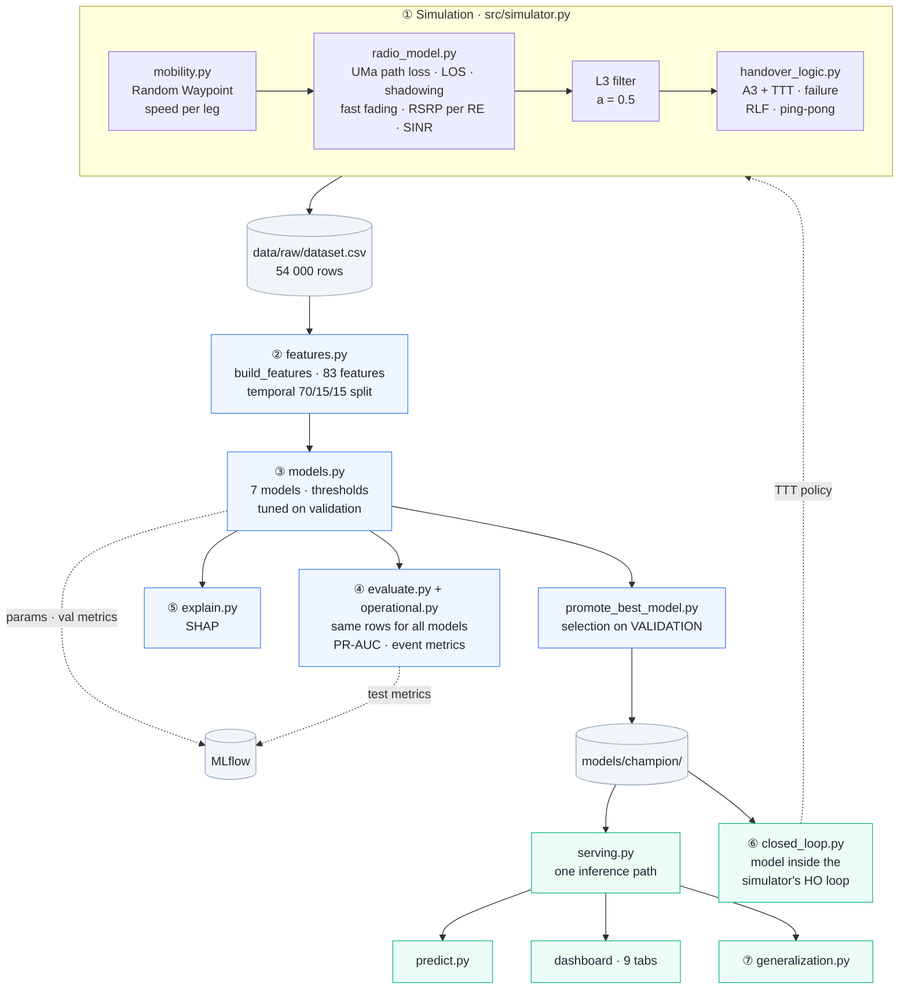

---

## 1 · Network simulation

One step loop (`src/simulator.py`) is shared by the training run, the scenario generator, the generalization study and the closed-loop experiment. Mobility/channel and handover-failure draws use **two independent random streams**, so different handover policies see identical trajectories and fading.

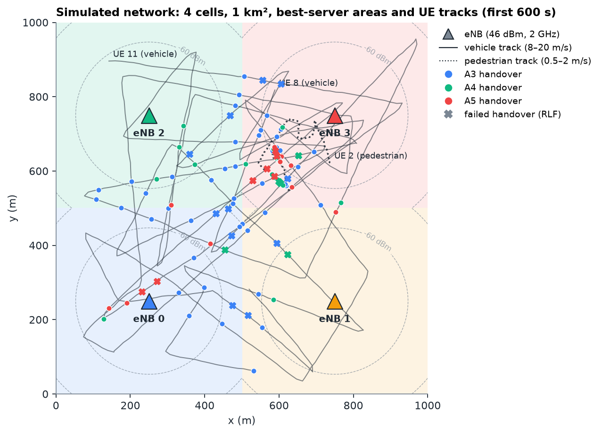

- **4 eNBs** on a 500 m grid: 46 dBm total, 2 GHz, 10 MHz (50 RB, 600 subcarriers).
- **15 UEs**: 8 pedestrians (0.5–2 m/s, short excursions, pauses) and 7 vehicles (8–20 m/s), with a new cruise speed on every waypoint leg.

### Radio model (`src/radio_model.py`)


| Component | Model |
|---|---|
| Path loss | 3GPP TR 36.873 UMa: LOS `22·log10(d) + 28 + 20·log10(fc)`; NLOS `max(PL_LOS, 19.55 + 39.09·log10(d))` |
| LOS / NLOS | `P(LOS|d) = min(18/d,1)(1−e^(−d/63)) + e^(−d/63)`, **spatially consistent**: a latent AR(1) process over distance travelled (50 m decorrelation, TR 38.901), LOS iff Φ(z) < P(LOS) |
| Shadowing | Gudmundson AR(1), σ = 4 dB (LOS) / 6 dB (NLOS), 100 m decorrelation |
| Fast fading | Rayleigh / Rician (K = 5 dB), **power-averaged over the 1 s measurement** (one independent sample per λ/2 travelled) |
| **RSRP** | reference-signal power **per resource element**: 46 dBm − 10·log10(600) = 18.2 dBm, reported in [−140, −44] dBm (TS 36.133) |
| SINR | `S / (Σ I_k · (0.1 + 0.9·load_k) + N)`, N = kTB over 9 MHz + 9 dB noise figure = −95.5 dBm |
| RSRQ, CQI | share of received power (approximation), TS 36.213 CQI table |
| L3 filter | `F = (1−a)·F + a·M`, a = 0.5 (TS 36.331 default k = 4) |

### Handover logic (`src/handover_logic.py`)

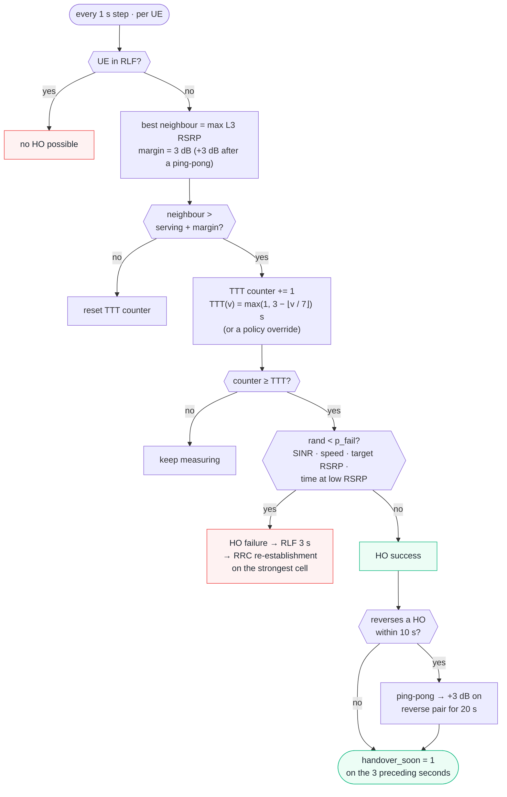

A3 is the only trigger. When the TTT expires, the attempt is labelled A5 (serving < −96 dBm and neighbour > −88 dBm), A4 (neighbour > −83 dBm) or A3, as a descriptive tag.

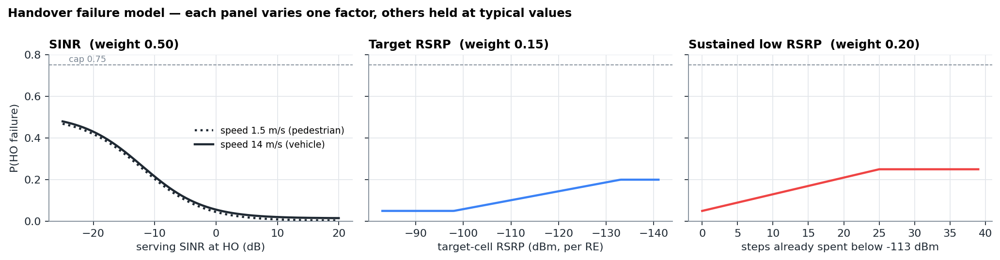

### v4 corrections

| v3 | Why it was wrong | v4 | Measured effect |
|---|---|---|---|
| RSRP from the 46 dBm total power | RSRP is defined per resource element | per-RE power, thresholds shifted by 27.8 dB, reported range capped at −44 dBm | 0 rows above −44 dBm (20 % before); SINR unchanged |
| LOS redrawn every 5 s regardless of motion | a standing UE does not change LOS state | spatially consistent LOS | pedestrian HO attempts 114 → 38 per hour; pedestrian ping-pong 27 % → 11 % |
| one Rayleigh sample per second | UEs average fading over the measurement period | power average over λ/2 samples | ±5 dB per-second jitter → ~1 dB |
| constant per-UE speed, non-zero when paused | speed acted as a UE id | new speed per leg, 0 when paused | physically meaningful feature |
| RLF lasted 2 steps; UE stayed on the failed cell | off-by-one; no re-establishment | exactly 3 steps, then re-establishment | — |
| failed attempts counted in the ping-pong history | a failure is not a handover | executed handovers only | — |

### The dataset


1,434 handover attempts in one hour (83.6 % successful, 16.4 % failed into RLF, 20.4 % of successes are ping-pongs). Vehicles hand over about 4× more often than pedestrians. The network is deliberately left unoptimised (fixed margin and TTT, no MRO), which leaves room for prediction to help.

---

## 2 · Features

`src/features.py` turns the raw measurements into **83 features**, computed per UE:

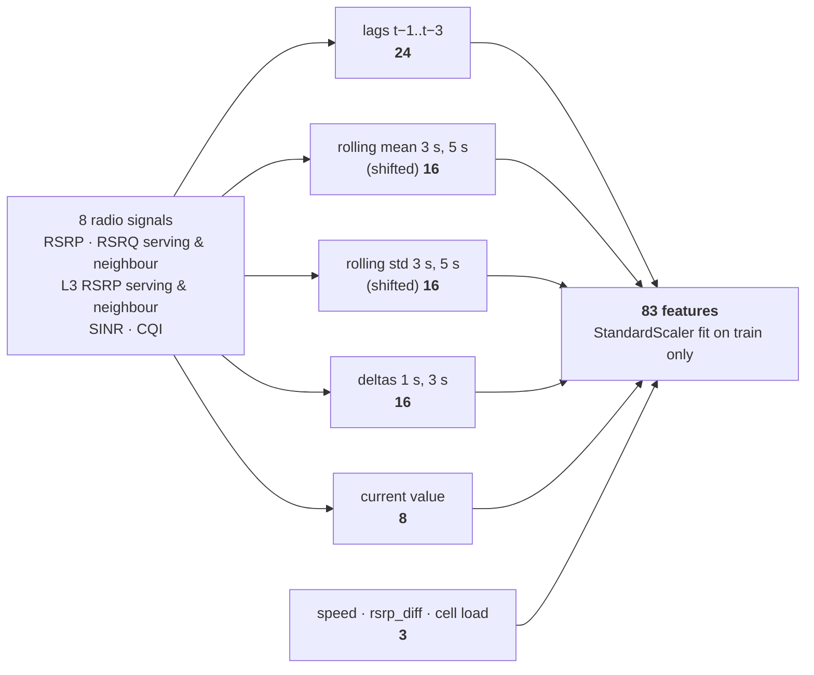

- **Only quantities a real network observes.** Position (`pos_x`, `pos_y`) and LOS state (`los_flag`) stay in the raw data for analysis but are not model inputs.
- **No leakage.** Rolling windows are shifted by one step, the split is by timestamp, and the scaler is fit on train. A test rewrites a UE's future and checks that past features don't move.
- **One builder, any row order.** `build_features()` groups by UE, sorts by time and keeps the input index. `OnlineFeatureBuffer` computes the same features second by second for the closed loop, and a parity test checks the two agree to within 1e-8.


---

## 3 · Models

| Model | Key settings | Imbalance handling |
|---|---|---|
| Rule (A3 gap) | `p = σ((L3_neighbour − L3_serving − 3 dB) / 2 dB)`, no learning | — |
| Logistic Regression | C = 0.5, saga | `class_weight` |
| Random Forest | 300 trees, depth 12, min leaf 5 | `class_weight` |
| XGBoost | depth 6, lr 0.05, subsample/colsample 0.8, **early stopping on validation PR-AUC** (~120 trees) | `scale_pos_weight` |
| LSTM / GRU | 2 × 64, dropout 0.3, 10 s window built **per UE**, checkpoint on validation PR-AUC | balanced sampler only |
| Stacking | balanced logistic meta-model over XGBoost + RF + LSTM; validation score **out-of-fold** | `class_weight` |

Every model gets its decision threshold tuned on validation (`models/thresholds.json`). The champion maximises `0.6·F1_val + 0.4·AUC_val`. The test split is read once, afterwards. All seeds are fixed, and two full `dvc repro` runs produce identical metrics for all seven models.

---

## 4 · Results

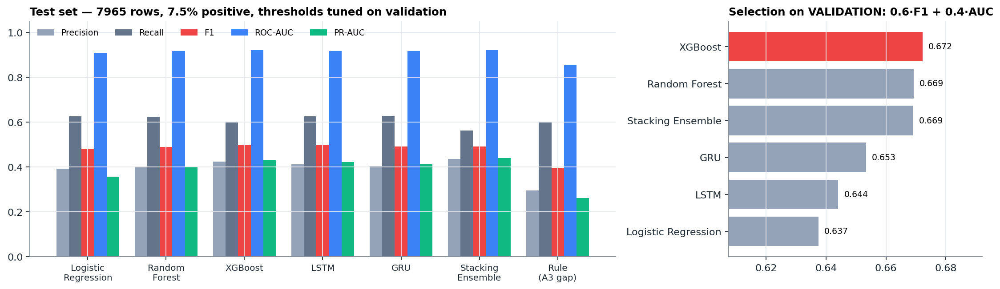

**Test split** (7,965 rows with a full 10 s history, the same rows for every model; 7.5 % positive; thresholds from validation):

| Model | Precision | Recall | F1 | ROC-AUC | PR-AUC |
|---|---|---|---|---|---|
| **XGBoost** ★ | 0.424 | 0.601 | **0.497** | 0.921 | 0.431 |
| LSTM | 0.413 | 0.627 | 0.498 | 0.916 | 0.423 |
| GRU | 0.405 | 0.628 | 0.492 | 0.916 | 0.414 |
| Stacking Ensemble | 0.435 | 0.563 | 0.491 | **0.923** | **0.441** |
| Random Forest | 0.403 | 0.623 | 0.489 | 0.916 | 0.401 |
| Logistic Regression | 0.392 | 0.627 | 0.482 | 0.909 | 0.356 |
| *Rule (A3 gap)* | *0.296* | *0.603* | *0.397* | *0.853* | *0.262* |

★ chosen on validation (score 0.672, vs 0.669 for Random Forest and Stacking).

<table>
<tr>
<td>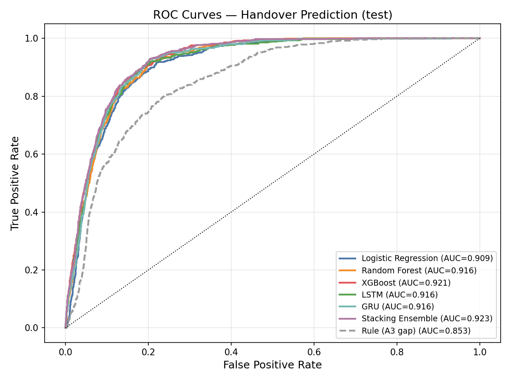</td>
<td>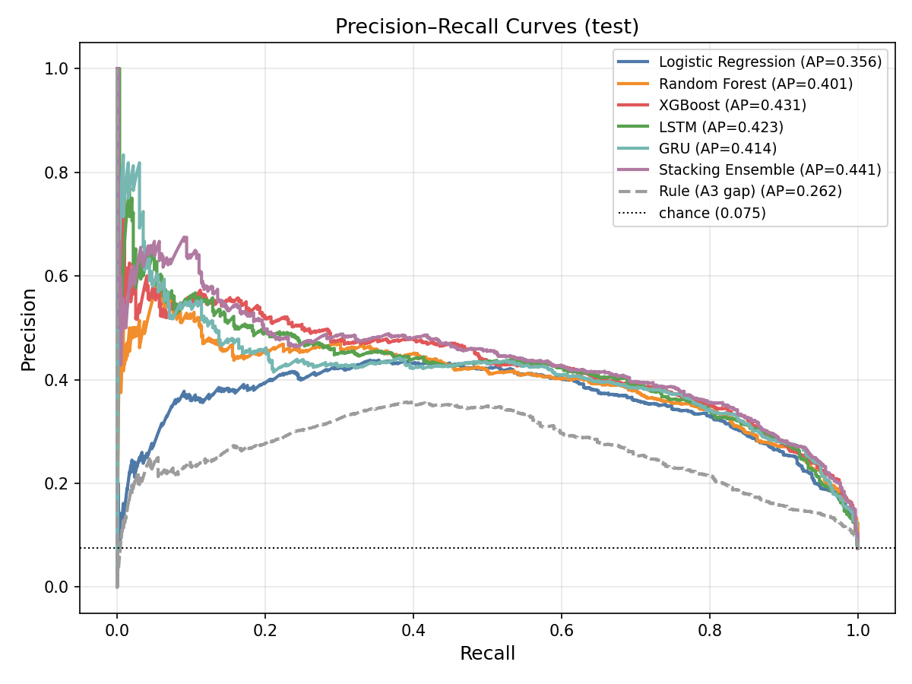</td>
</tr>
</table>

**Reading the results**

- **ML clearly beats the rule.** +0.10 F1, +0.07 ROC-AUC and 1.6× the PR-AUC. At the same recall (~60 %), precision rises from 30 % to 42 %.
- **The learned models are within noise of each other** (F1 0.48–0.50). The champion was decided by 0.003 on validation, so the ranking among them isn't meaningful.
- **F1 ≈ 0.5 is the honest ceiling of this label, not underfitting.** Predicting a stochastic event 3 s ahead is hard: some handovers have no precursor that early (shadowing, LOS transitions). ROC-AUC 0.92 shows the ranking is good.
- **PR-AUC matters more than ROC-AUC here.** With 7.5 % positives, ROC-AUC stays high even with many false alarms. PR-AUC measures alarm precision, which is what an operator pays for.

---

## 5 · Operational evaluation

An operator counts **handovers anticipated** and **the cost of alarms**, not correctly classified seconds. `src/operational.py` measures:

- **event recall@3 s:** the share of successful handovers preceded by an alarm in the 3 s before;
- **lead time;**
- **false-alarm time:** the share of seconds with an alarm that isn't followed by a handover within 3 s, i.e. time spent preparing a handover for nothing.

Counting false alarms *per episode* would reward a model that alarms permanently, so the cost is measured in time.

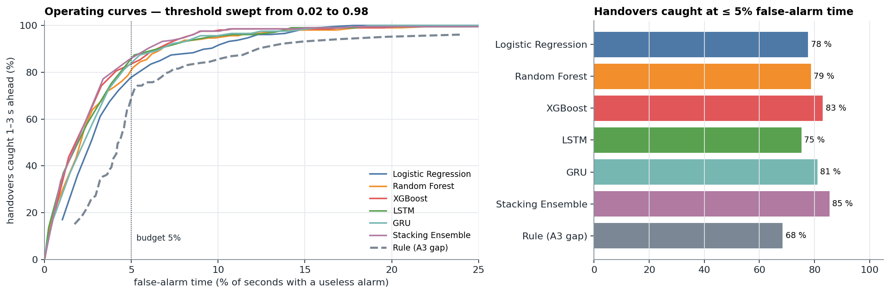

At its tuned threshold the champion flags **89 %** of handovers within 3 s (91 % within 5 s), with the first alarm on average **3.4 s** ahead, for 6.1 % false-alarm time. At the same **5 % false-alarm budget** for every model, it catches **83 %** of handovers, against **68 %** for the A3 rule.

---

## 6 · Closed loop: does prediction help the network?

`src/closed_loop.py` re-runs the simulator on **3 unseen seeds × 1,800 s** with a time-to-trigger policy inside the handover loop. The champion scores every UE online, every second.

| Policy | Rule |
|---|---|
| baseline | velocity-aware TTT (the training data) |
| always_short / always_long | TTT = 1 s / 4 s for everyone |
| **predictive** | p ≥ 0.80 → TTT 1 s; A3 met and p < 0.17 → TTT + 2 s; otherwise default |
| random_gate | the same overrides **at the same rates**, at random UE-seconds (control) |

Both thresholds come from validation: 0.80 is the champion's tuned threshold, and 0.17 is the 5th percentile of its validation scores on true positives.

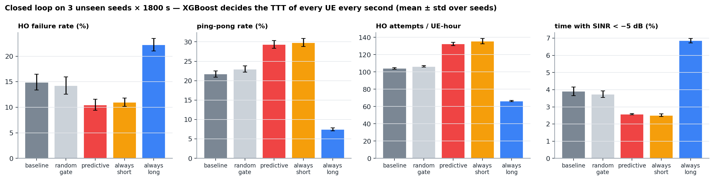

| Policy | HO failures | Ping-pong | RLF s / UE-h | SINR at HO | Time SINR < −5 dB |
|---|---|---|---|---|---|
| baseline | 14.9 % | 21.7 % | 62.1 | −6.2 dB | 3.9 % |
| random_gate | 14.2 % | 23.0 % | 60.6 | −5.9 dB | 3.7 % |
| **predictive** | **10.5 %** | 29.4 % | **55.5** | **−4.1 dB** | **2.6 %** |
| always_short | 11.0 % | 29.8 % | 59.6 | −4.0 dB | 2.5 % |
| always_long | 22.3 % | 7.5 % | 59.1 | −10.1 dB | 6.9 % |

**What this shows**

- **The model picks the right moments.** At the same intervention rate, the random control barely moves anything. The predictive policy cuts handover failures by ~30 % and raises SINR at execution by 2 dB.
- **But a plain short TTT does almost as well.** The predictive policy is marginally better on every metric, but the margins are within one standard deviation across seeds.
- **The mobility trade-off is unavoidable.** Earlier handovers fail less but ping-pong more; a long TTT does the reverse. Predicting *that* a handover is coming isn't enough to beat this trade-off. The next step is to predict *whether it will be a ping-pong*.
- **Caveat:** the model was trained on baseline-policy data, so policies that move handover timing shift its input distribution slightly.

---

## 7 · Generalization

`src/generalization.py` scores the champion and the rule on **fresh simulations** never used for training or selection: the four scenario presets (8 UEs × 1,800 s) and three unseen seeds of the training configuration.

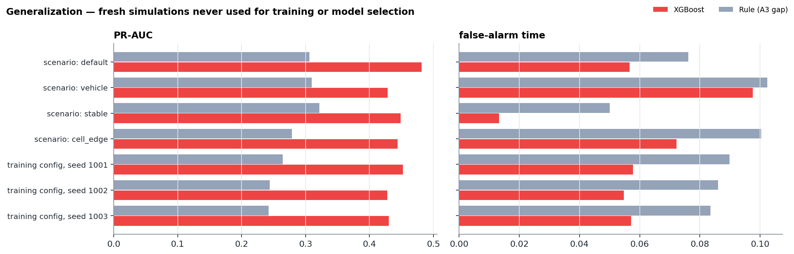

On unseen seeds the champion keeps **ROC-AUC 0.93 and PR-AUC 0.43–0.45**, the same as the test split. The vehicle-only scenario is hardest (ROC-AUC 0.87), because at high speed the TTT is 1 s and precursors are short. The champion beats the rule on every dataset, in both PR-AUC and false-alarm time.

---

## 8 · Explainability (SHAP)

`src/explain.py` writes bar, beeswarm and waterfall plots for Logistic Regression (`LinearExplainer`), Random Forest and XGBoost (`TreeExplainer`) and the Stacking Ensemble (`KernelExplainer` over the three base probabilities) to `reports/shap/`, and logs them to MLflow.

For the XGBoost champion, mean |SHAP| ranks **UE speed (17.7 %)**, **`rsrp_diff` (14.9 %)**, **SINR (9.8 %)** and **serving RSRQ (8.7 %)** highest:

- `rsrp_diff` reproduces A3: a strongly negative contribution while the serving cell clearly dominates.
- Speed acts as a prior, because vehicles hand over ~4× more often.
- Lags, rolling stats and deltas together account for ~37 % of the attribution. They refine the current state rather than replace it.

---

## MLOps, tests and serving

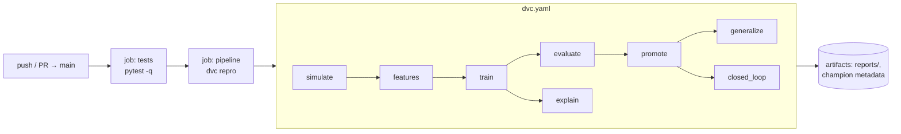

- **DVC:** 8 stages with explicit dependencies; `dvc repro` reruns only what changed. JSON reports and validation thresholds are committed (`cache: false`), so every number in this README can be checked. Data and models are regenerated from the seeded simulator; there's no remote to configure.
- **MLflow:** each training run logs hyperparameters, validation metrics and the model; evaluation appends test metrics and plots to the same run. `mlflow ui --backend-store-uri sqlite:///mlflow.db`.
- **CI:** GitHub Actions runs the tests, then the whole pipeline, and uploads the reports.
- **Tests (36):** radio physics, the handover state machine, simulator determinism, *policy does not change trajectories*, label correctness, *no leakage*, online/offline parity, *row order does not change scores*, LSTM windows never crossing UEs, and the event metrics. Several reproduce bugs found in v3.
- **Serving:** `src/serving.py` is the single inference path (`build_features` → scaler → model → scores joined back **by index**). It's shared by:
  - `predict.py`, which scores raw measurement CSVs in any row order and reports warm-up rows instead of zero-filling them;
  - the 9-tab Streamlit dashboard: radio KPIs, HO timeline, risk map, live prediction, model comparison with event metrics, SHAP, MLflow, mobility map, and a **Proactive HO** tab for the closed loop and generalization;
  - the generalization study.

```
$ python predict.py --csv data/test_scenarios/default_ues5_steps300_seed42.csv
Model: XGBoost

  UE      t     Prob  Decision  (threshold=0.80)
--------------------------------------------
   0      0        -  warm-up (needs 3 s of history)
   ...
1485 of 1500 rows scored, 15 warm-up, 122 handover alarms.
```

---

## Limitations and next steps

- **Synthetic data.** The radio models follow 3GPP, but the real test would be operator traces (drive tests, OSS counters).
- **1 s time step.** Real UEs measure every ~200 ms and TTT goes down to 40 ms.
- **LOS transitions are hard switches** of about 20 dB, the main remaining source of pedestrian handovers (~38 per hour, more than a real network). A soft-LOS variant was tried and increased the count, so it wasn't kept.
- **Small network.** Four omni cells, no sectorisation and no wrap-around; RSRQ is approximated; A4/A5 are labels, not triggers; the failure model is heuristic.
- **Closed loop.** Prediction alone does not beat the short-TTT/ping-pong trade-off. Next steps: predict ping-pongs or handover quality, retrain under the new policy, or learn TTT/CIO with reinforcement learning, and predict the target cell.

---

## Repository structure

<details>
<summary><b>Show tree</b></summary>

```
├── simulate.py                  # training simulation (wrapper around src/simulator.py)
├── generate_test_dataset.py     # scenario CSVs (default, vehicle, stable, cell_edge)
├── run_pipeline.py              # phases 2–5
├── predict.py                   # CLI inference on raw measurements
├── dvc.yaml / dvc.lock          # 8-stage pipeline
├── requirements.txt / requirements-dev.txt
│
├── src/
│   ├── simulator.py             # shared step loop, RLF / re-establishment, label
│   ├── radio_model.py           # propagation, per-RE RSRP, SINR, RSRQ, CQI
│   ├── mobility.py              # Random Waypoint, actual speed
│   ├── handover_logic.py        # L3 filter, A3 + TTT, failure, ping-pong
│   ├── features.py              # 83 features, build_features, OnlineFeatureBuffer
│   ├── models.py                # 7 models, thresholds, per-UE sequence scoring
│   ├── evaluate.py              # same-row evaluation, ROC / PR curves
│   ├── operational.py           # event recall, lead time, false-alarm time
│   ├── explain.py               # SHAP
│   ├── serving.py               # single inference path
│   ├── closed_loop.py           # model-in-the-loop experiment
│   └── generalization.py        # unseen scenarios and seeds
│
├── scripts/                     # champion promotion, figures, course PDF
├── app/dashboard.py             # Streamlit dashboard (9 tabs)
├── tests/                       # 36 pytest tests
├── notebooks/                   # 01–10, executed with v4 outputs
├── reports/*.json               # committed metric summaries
├── models/champion/metadata.json, models/thresholds.json
└── docs/
    ├── cours/                   # French course (11 chapters + PDF)
    ├── technical_report.md, Architecture.md
    └── img/                     # figures (python scripts/make_figures.py)
```

</details>

---

## Author

**Souhail Bourhim** · LTE network simulation and ML pipeline.
