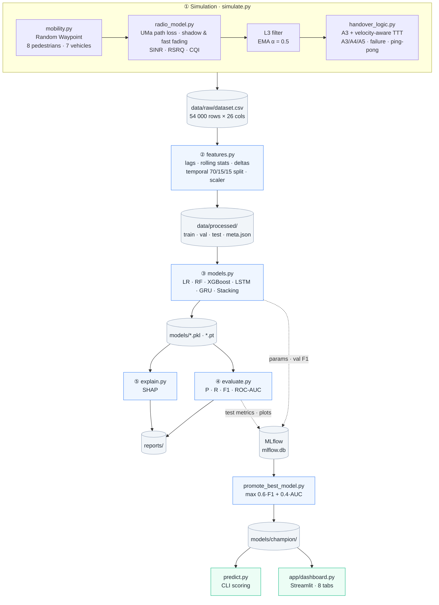
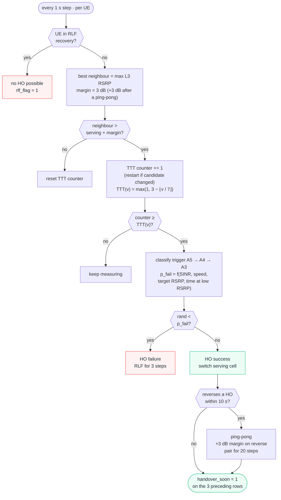
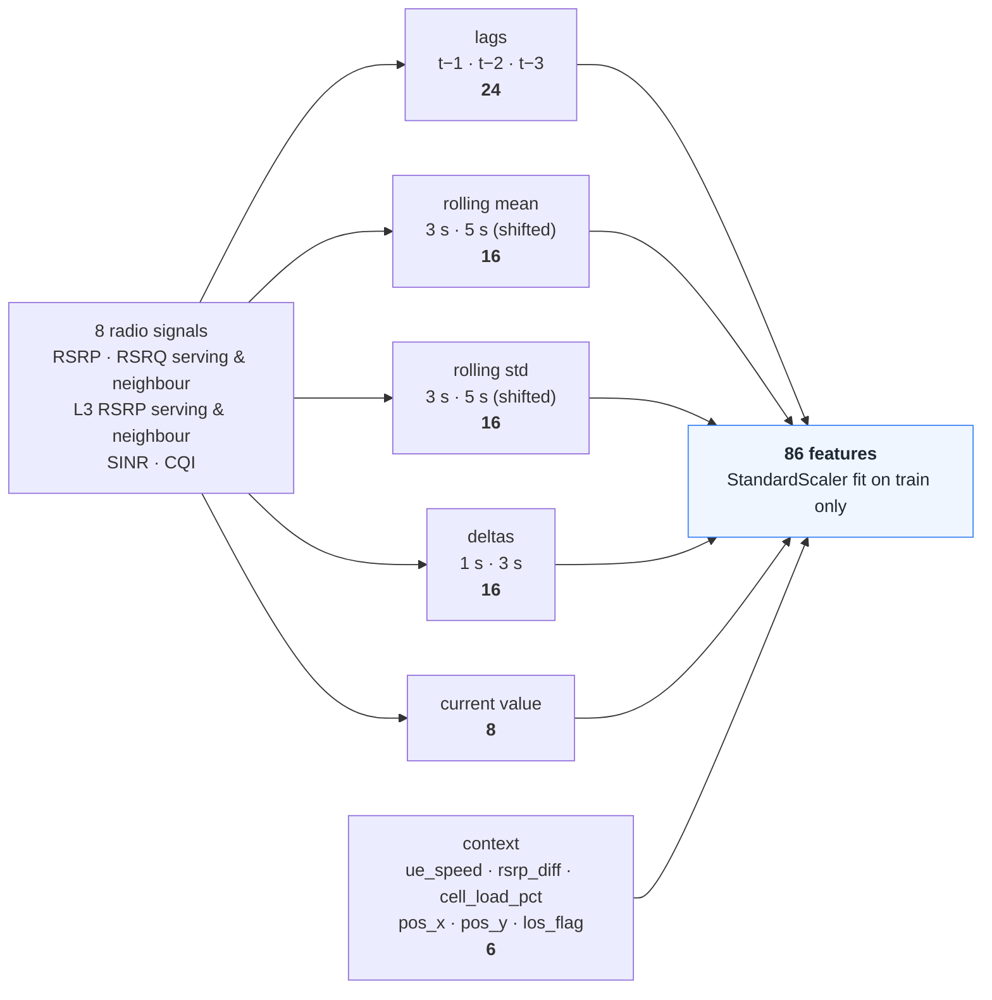
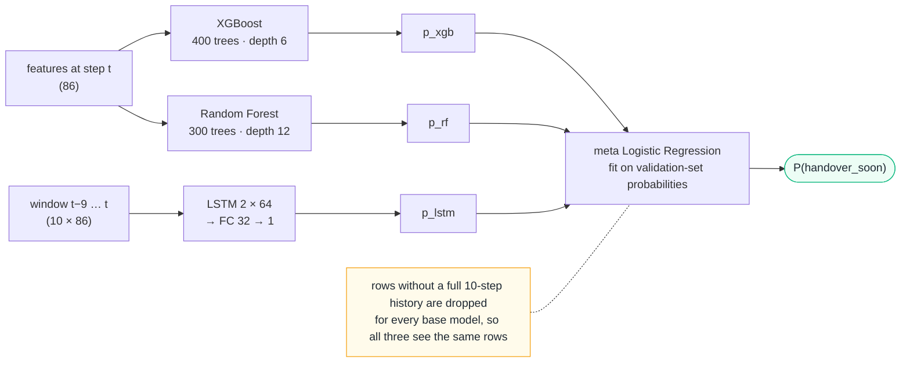
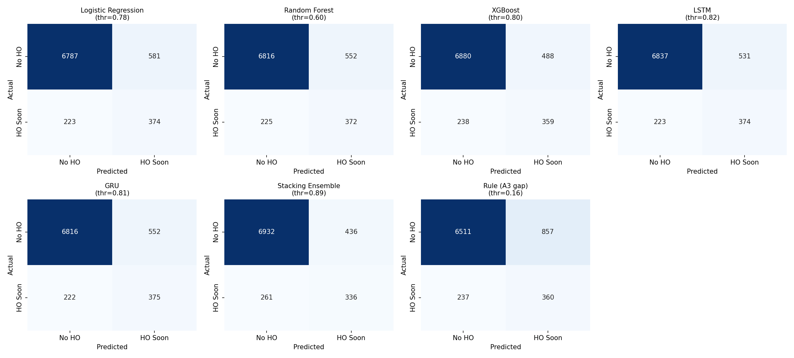
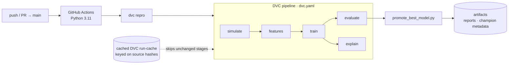

# Intelligent Handover Prediction in LTE Networks

[](https://github.com/SouhailBourhim/Intelligent-Handover-Prediction-LTE/actions/workflows/ci.yml)


**Can a model tell, from a phone's radio measurements, that it is about to be handed over to another cell, before the network itself decides?**

This project answers that end to end. No public dataset exists for this task, so the pipeline starts one layer lower than most ML projects. It builds a **3GPP-style LTE radio simulator**, generates 54,000 labelled measurements from it, and then trains, tracks, explains and serves six classifiers that predict `handover_soon`: *a successful handover will happen within the next 3 seconds*.


<sub>One real handover from the simulated dataset. The serving cell (blue) fades while a neighbour (orange) rises. Once the neighbour has been 3 dB stronger for the time-to-trigger, the network hands over. The bottom strip is what the models learn to predict: the label switches on **3 s before** the handover, often before the A3 condition is even met.</sub>

---

## At a glance

| | |
|---|---|
| **Task** | Binary time-series classification of `handover_soon` (3-step look-ahead) |
| **Data** | 54,000 rows · 15 UEs (8 pedestrians, 7 vehicles) · 4 eNBs · 3,600 s · 10.8 % positive |
| **Simulator** | 3GPP UMa LOS/NLOS path loss, shadow + fast fading, load-aware SINR, L3 filtering, A3/A4/A5 events, TTT, HO failure, ping-pong |
| **Features** | 86 (lags, shifted rolling stats, deltas, context) · temporal split · no look-ahead |
| **Models** | Logistic Regression · Random Forest · XGBoost · LSTM · GRU · Stacking Ensemble |
| **Champion** | **XGBoost**: F1 0.550 · ROC-AUC 0.919, chosen by `0.6·F1 + 0.4·AUC` |
| **MLOps** | DVC pipeline · MLflow tracking · automatic champion promotion · GitHub Actions CI |
| **Serving** | `predict.py` CLI · 8-tab Streamlit dashboard with live CSV scoring |

**On the F1 score:** handovers are rare, and the label asks for a prediction 3 s ahead of a stochastic event. F1 ≈ 0.55 at a ROC-AUC above 0.9 means the models separate the classes well. The ceiling comes from label noise and class imbalance, not from underfitting. See [Results](#4--results).

---

## Contents

1. [Quickstart](#quickstart)
2. [System architecture](#system-architecture)
3. [Phase 1: Network simulation](#1--network-simulation)
4. [Phase 2: Feature engineering](#2--feature-engineering)
5. [Phase 3: Models](#3--models)
6. [Phase 4: Results](#4--results)
7. [Phase 5: Explainability (SHAP)](#5--explainability-shap)
8. [MLOps: DVC, MLflow, CI, champion promotion](#mlops)
9. [Serving: dashboard and CLI](#serving)
10. [Limitations and next steps](#limitations-and-next-steps)
11. [Repository structure](#repository-structure)

---

## Quickstart

```bash
git clone https://github.com/SouhailBourhim/Intelligent-Handover-Prediction-LTE.git
cd Intelligent-Handover-Prediction-LTE

python3 -m venv .venv && source .venv/bin/activate      # Python 3.11
pip install -r requirements.txt

python simulate.py                     # 1. simulate the network  → data/raw/dataset.csv
python run_pipeline.py                 # 2–5. features → train → evaluate → SHAP
python scripts/promote_best_model.py   # pick the champion        → models/champion/
streamlit run app/dashboard.py         # explore everything in the browser
```

Run a single phase with `python run_pipeline.py --phase {2,3,4,5}`, or let DVC rerun only stale stages with `dvc repro`.

---

## System architecture



`run_pipeline.py` is the single entry point for phases 2–5. `dvc.yaml` mirrors the same stages so they can be reproduced and cached, and that is what CI runs.

---

## 1 · Network simulation

`simulate.py` assembles three modules from `src/` into a 1 km² urban macro-cell network. It runs at 1 s per step for 3,600 steps.

### Topology and mobility


- **4 eNBs** on a 500 m grid, 46 dBm, 2 GHz carrier, 10 MHz bandwidth (noise floor −107 dBm).
- **15 UEs** moving under a Random Waypoint model with direction persistence:
  - **Pedestrians** (0.5–2 m/s): short 200 m excursions, noisy heading, pauses at waypoints.
  - **Vehicles** (8–20 m/s): waypoints anywhere on the grid, smooth heading, no pauses.
  - Elastic reflection at the grid boundary.

Shadow fading means handovers do not only happen on the geometric cell borders. UE 2 above is a pedestrian walking at 1.35 m/s that makes 20 handover attempts in 10 minutes, 9 of them ping-pongs, without leaving a 200 m × 200 m patch. That is exactly the kind of behaviour a predictor has to cope with.

### Radio model (`src/radio_model.py`): 3GPP TR 36.873 UMa


| Component | Model |
|---|---|
| LOS / NLOS state | Sampled per link from `P(LOS\|d) = min(18/d,1)·(1−e^(−d/63)) + e^(−d/63)`, re-evaluated every 5 s |
| Path loss | LOS `22·log10(d) + 28 + 20·log10(fc)`; NLOS `max(PL_LOS, 19.55 + 39.09·log10(d))` |
| Shadow fading | Gudmundson AR(1), σ = 4 dB (LOS) / 6 dB (NLOS), 100 m decorrelation |
| Fast fading | AR(1) complex Gaussian: Rayleigh (NLOS) / Rician K = 5 dB (LOS), 1 s averaged |
| SINR | Load-weighted interference `S / (Σ P_nb · (0.10 + 0.90·load) + N)` |
| CQI | 15-level SINR → CQI table (TS 36.213) |
| L3 filter | EMA α = 0.5 on RSRP, which is what the handover logic sees |

### Handover logic (`src/handover_logic.py`)



| Event | Condition on L3-filtered RSRP | Meaning |
|---|---|---|
| **A5** | serving < −68 dBm **and** neighbour > −60 dBm | coverage emergency |
| **A4** | neighbour > −55 dBm | strong target |
| **A3** | neighbour > serving + margin | relative (default) |

**Velocity-aware time-to-trigger.** Faster UEs get a shorter TTT, `max(1, 3 − ⌊v/7⌋)` steps, so a vehicle at 15 m/s triggers after 1 s and a pedestrian after 3 s.

**Handover failure** is a weighted mix of four factors, capped at 0.75. Overall about 21 % of attempts fail and send the UE into radio-link failure (RLF) for 3 s:


### The dataset


The simulation emits 26 columns per UE per second. The gap between serving and neighbour RSRP (right panel) is the single most informative raw signal. Positives cluster where the neighbour is already close to or stronger than the serving cell, but the two distributions overlap heavily. That overlap is why temporal features matter.

<details>
<summary><b>All 26 dataset columns</b></summary>

| Column | Description |
|--------|-------------|
| `timestamp` | Simulation step (s) |
| `ue_id` | UE identifier (0–14; 0–7 pedestrians, 8–14 vehicles) |
| `serving_cell_id` | Current serving eNB (0–3) |
| `rsrp_serving` | Instantaneous RSRP from serving eNB (dBm) |
| `rsrq_serving` | RSRQ from serving eNB (dB) |
| `sinr` | Serving-cell SINR (dB) |
| `cqi` | Channel Quality Indicator (1–15) |
| `best_neighbor_cell_id` | Strongest neighbour eNB |
| `rsrp_neighbor` | Instantaneous RSRP from best neighbour (dBm) |
| `rsrq_neighbor` | RSRQ from best neighbour (dB) |
| `rsrp_diff` | `rsrp_serving − rsrp_neighbor` (dB); negative means the neighbour is stronger |
| `l3_rsrp_serving` | L3-filtered serving RSRP, the value the HO logic uses (dBm) |
| `l3_rsrp_neighbor` | L3-filtered neighbour RSRP (dBm) |
| `ue_speed` | UE speed (m/s) |
| `pos_x`, `pos_y` | UE position (m), simulation ground truth |
| `los_flag` | 1 if the serving link is LOS, simulation ground truth |
| `serving_cell_load` | UEs attached to the serving cell |
| `cell_load_pct` | Serving-cell load (0–100 %) |
| `handover_event` | 1 if a HO attempt was made this step |
| `target_cell_id` | Target eNB (−1 if no HO) |
| `event_type` | `A3` / `A4` / `A5` / `none` |
| `handover_failure` | 1 if the attempt failed (→ RLF) |
| `ping_pong` | 1 if this HO reversed a recent one |
| `rlf_flag` | 1 if the UE is in RLF recovery |
| `handover_soon` | **Label**: a *successful* HO occurs within the next 3 steps |

</details>

### Why a 3-second look-ahead?

- **1–2 s:** easier to predict, but too late for the network to prepare the target cell.
- **3 s:** enough time for standard X2-based handover preparation. This is the chosen trade-off.
- **5–10 s:** more useful operationally, but mobility over that horizon is close to random, so label noise rises sharply and the achievable precision drops.

---

## 2 · Feature engineering

`src/features.py` turns 26 raw columns into **86 model features**, computed independently per UE:



**Leakage guards**

- Lags and deltas look backwards only. Rolling windows are **shifted by one step**, so they never include the current row.
- The first 3 rows of each UE (incomplete history) are dropped.
- The split is **by timestamp, never shuffled**. The scaler is fit on the training block only.


---

## 3 · Models

| Model | Key settings |
|-------|-------------|
| Logistic Regression | `C=0.5`, saga solver, `class_weight='balanced'` |
| Random Forest | 300 trees, `max_depth=12`, `class_weight='balanced'` |
| XGBoost | 400 trees, `max_depth=6`, `lr=0.05`, early stopping (20 rounds) on validation |
| LSTM | 2 layers × 64 hidden → FC 32 → 1, 10-step window, `WeightedRandomSampler` |
| GRU | Same as LSTM with GRU cells, a lighter recurrent alternative |
| Stacking Ensemble | Meta logistic regression over XGBoost + RF + LSTM probabilities |



**Stacking alignment.** The recurrent models cannot score the first `SEQ_LEN − 1` rows of each UE. `_build_seq_row_indices()` rebuilds that exact row subset so the tree models produce meta-features for the same rows. The same alignment is used in training, evaluation and notebook 10.

---

## 4 · Results


| Model | Precision | Recall | F1 | ROC-AUC | Score† |
|-------|-----------|--------|----|---------|--------|
| Logistic Regression | 0.352 | **0.869** | 0.501 | 0.898 | 0.660 |
| Random Forest | 0.433 | 0.736 | 0.545 | 0.911 | 0.691 |
| **XGBoost** ★ | 0.426 | 0.778 | **0.550** | **0.919** | **0.698** |
| LSTM | 0.342 | 0.781 | 0.476 | 0.881 | 0.638 |
| GRU | 0.332 | 0.809 | 0.471 | 0.865 | 0.628 |
| Stacking Ensemble | **0.561** | 0.403 | 0.469 | **0.919** | 0.649 |

<sub>† Score = 0.6 × F1 + 0.4 × AUC, the champion promotion criterion. All metrics are on the held-out last 15 % of simulated time, at a 0.5 threshold.</sub>

<table>
<tr>
<td></td>
<td></td>
</tr>
</table>

**Reading the results**

- **XGBoost wins on F1** and ties the Stacking Ensemble on AUC (0.9188 vs 0.9190), so it is the champion.
- **The Stacking Ensemble ranks well but is badly calibrated at 0.5.** It has the highest precision (0.561), but at the default threshold it misses about 60 % of imminent handovers. Lowering the threshold to 0.25–0.30 recovers most of the recall. The weighted score penalises it for low F1 at 0.5.
- **The recurrent models do not beat the trees here.** The engineered lag and rolling features already give the tree models the temporal context the LSTM/GRU would otherwise learn.
- **Reproducibility.** LR, RF and XGBoost use `random_state=42` and reproduce exactly. LSTM, GRU and Stacking are not seeded (no `torch.manual_seed`, unseeded sampler), so their rows move by about ±0.015 F1 between runs.

---

## 5 · Explainability (SHAP)

`src/explain.py` explains four models and writes 12 plots to `reports/shap/` (bar, beeswarm and waterfall for each). The plots are also logged to each model's MLflow run.

| Model | Explainer | Why |
|---|---|---|
| Logistic Regression | `LinearExplainer` | Exact and analytical |
| Random Forest, XGBoost | `TreeExplainer` | Exact tree-path SHAP, fast |
| Stacking Ensemble | `KernelExplainer` | Model-agnostic over the 3 base-model probabilities, showing which base model drives each prediction |

LSTM and GRU are left out: `DeepExplainer` is slow and noisier than tree SHAP.

For the tree models, the most important features are **deltas and rolling statistics of the serving/neighbour RSRP gap**. What signals an imminent handover is how fast the gap is closing, not its current value. Notebook 09 goes further with dependency plots and per-UE temporal SHAP.

---

<a id="mlops"></a>

## MLOps: DVC, MLflow, CI and champion promotion



**DVC.** `dvc.yaml` declares five stages with explicit dependencies and outputs. `dvc repro` reruns only the stages whose inputs changed, and `dvc dag` prints the graph.

**MLflow (optional).** Every training run logs hyperparameters, validation F1 and the model artifact. Evaluation then *resumes the same run*, using `models/mlflow_run_ids.json`, to append test metrics and plots. The store is a local SQLite file (`mlflow.db`, gitignored), so no server is needed and the full MLflow UI works:

```bash
mlflow ui --backend-store-uri sqlite:///mlflow.db     # http://localhost:5000
```

All MLflow calls are wrapped in `try/except`, so the pipeline runs fine without MLflow installed.

**Champion promotion.** `scripts/promote_best_model.py` picks the run with the highest **0.6 × F1 + 0.4 × AUC**, copies its artifact to `models/champion/` and writes `metadata.json`. If MLflow is unavailable, it falls back to parsing `reports/evaluation.txt`.

*Why weight F1 above AUC?* A missed handover can mean a dropped connection and RLF recovery. A false alarm only triggers a preparation phase that the network can abort cheaply. Pure AUC can crown a model that ranks well but misses most real handovers at its operating threshold, which is exactly what happens with the Stacking Ensemble above.

**CI** (`.github/workflows/ci.yml`) runs on every push and PR to `main`. It installs dependencies, restores the DVC run-cache, runs `dvc repro`, promotes the champion, and uploads `reports/` plus the champion metadata as 30-day artifacts. There is no separate unit-test suite: the end-to-end pipeline run is the integration test.

<details>
<summary><b>Querying runs from Python</b></summary>

```python
import mlflow

mlflow.set_tracking_uri("sqlite:///mlflow.db")
client = mlflow.tracking.MlflowClient()
exp = client.get_experiment_by_name("lte_handover_prediction")

for r in client.search_runs([exp.experiment_id], order_by=["metrics.test_roc_auc DESC"]):
    name = r.data.tags.get("mlflow.runName")
    print(f"{name:<25} AUC={r.data.metrics.get('test_roc_auc'):.4f}  F1={r.data.metrics.get('test_f1'):.4f}")
```

</details>

---

<a id="serving"></a>

## Serving: dashboard and CLI

### Streamlit dashboard (`app/dashboard.py`)

```bash
streamlit run app/dashboard.py
```

| Tab | What it shows |
|-----|---------|
| 📊 Radio KPIs | RSRP, SINR, RSRQ and CQI over time with handover markers |
| 🔁 HO Timeline | Handover events by UE and target cell |
| ⚠️ Risk | Per-UE risk heatmap and a gauge for the selected model |
| 🔮 Live Prediction | Upload a raw-measurement CSV (or type values) and score it with the champion; features are engineered on the fly |
| 📋 Model Comparison | Metrics parsed from `reports/evaluation.txt` |
| 🔍 SHAP Explanations | Bar / beeswarm / waterfall plots, with an on-demand recompute |
| 🧪 MLflow Runs | Live query of `mlflow.db` |
| 🗺️ Mobility Map | UE tracks and eNB positions |

A champion banner at the top reads `models/champion/metadata.json`.

**Test data for Live Prediction.** `generate_test_dataset.py` simulates fresh CSVs from four scenario presets. Pre-generated samples are in `data/test_scenarios/`:

| Scenario | Description | HO-soon rate |
|---|---|---|
| `default` | Mixed pedestrians and vehicles | 12.5 % |
| `vehicle` | Fast vehicles only (8–20 m/s) | 15.1 % |
| `stable` | Slow pedestrians near eNBs | 5.0 % |
| `cell_edge` | UEs seeded along cell boundaries | 15.0 % |

```bash
python generate_test_dataset.py --scenario vehicle --ues 8 --steps 500
```

### CLI (`predict.py`)

```bash
python predict.py --info                              # champion name, AUC, promotion time
python predict.py --csv features.csv                  # score a CSV
python predict.py --csv features.csv --threshold 0.35 # custom operating point
python predict.py --json '{"rsrp_serving": -85, ...}' # score one row
```

```
Model: xgboost  |  AUC=0.9188

    UE     Prob    Decision  (threshold=0.50)
───────────────────────────────────────────
     3   0.7821  ⚠  HANDOVER
     3   0.0431  ✓  ok
```

The CLI handles sklearn, PyTorch and stacking champions transparently.

> **Note:** `predict.py` currently expects the engineered columns (lags, rolling stats, deltas) to be in the input, and skips rows where more than 10 % of them are missing. To score raw measurements such as `data/test_scenarios/*.csv`, use the dashboard's Live Prediction tab, which engineers features itself.

---

## Limitations and next steps

- **Synthetic data.** Every number here comes from a simulator. The radio models follow 3GPP, but real drive-test or OSS traces would be the real test.
- **Simulation-only inputs.** `pos_x`, `pos_y` and `los_flag` are in the feature set. A real network does not observe them directly, so a deployable model should drop them and be retrained.
- **RSRP range.** About 20 % of rows have serving RSRP above −44 dBm, the top of the 3GPP reporting range (the simulator clamps at −25 dBm). Real UEs would report these as −44, so a model trained on real data would see a saturated signal near the eNBs.
- **Unseeded deep models.** LSTM/GRU/Stacking results vary by about ±0.015 F1 between runs. Seeding PyTorch and the sampler would make the whole table reproducible.
- **Threshold tuning.** All results use a 0.5 threshold. Picking an operating point per model on the validation set (notebook 10 has the sweep) would change the ranking, most of all for the Stacking Ensemble.

---

## Notebooks

All 10 notebooks are committed with outputs. Re-executing them needs the project environment (`lte_venv` kernel or `.venv`).

| # | Notebook | Content |
|---|---|---|
| 01 | Data generation | Simulator walkthrough |
| 02 | Feature engineering | Lag / rolling / delta deep-dive |
| 03 | Modeling | Training step by step |
| 04 | Evaluation | ROC and confusion matrices |
| 05 | Dashboard preview | Static preview of the app |
| 06 | Simulation realism | v3 radio-model analysis |
| 07 | Model impact | Side-by-side comparison |
| 08 | MLflow tracking | Run comparison, radar chart, champion spotlight |
| 09 | SHAP explanations | Beeswarm, dependence, waterfall, temporal SHAP per UE |
| 10 | Model comparison | PR curves, calibration, threshold sweep, speed benchmark, error analysis |

```bash
jupyter nbconvert --to notebook --execute --inplace \
  --ExecutePreprocessor.timeout=300 --ExecutePreprocessor.kernel_name=lte_venv \
  notebooks/<notebook>.ipynb
```

---

## Repository structure

<details>
<summary><b>Show tree</b></summary>

```
├── simulate.py                  # Phase 1: LTE network simulation → data/raw/dataset.csv
├── run_pipeline.py              # Phases 2–5 runner (--phase N for one phase)
├── predict.py                   # CLI inference with the champion model
├── generate_test_dataset.py     # Scenario CSVs for live prediction
├── dvc.yaml / dvc.lock          # 5-stage reproducible pipeline
├── requirements.txt             # Pinned dependencies (Python 3.11)
│
├── src/
│   ├── radio_model.py           # Path loss, fading, SINR, RSRQ, CQI
│   ├── mobility.py              # Random Waypoint mobility + UE state
│   ├── handover_logic.py        # A3/A4/A5, TTT, failure, ping-pong
│   ├── features.py              # Phase 2: features, temporal split, scaler
│   ├── models.py                # Phase 3: 6 models + MLflow logging
│   ├── evaluate.py              # Phase 4: metrics, ROC, confusion matrices
│   └── explain.py               # Phase 5: SHAP
│
├── scripts/
│   ├── promote_best_model.py    # Champion selection → models/champion/
│   └── make_figures.py          # Regenerates the README figures in docs/img/
│
├── app/dashboard.py             # Streamlit dashboard (8 tabs)
├── notebooks/                   # 01–10, committed with outputs
├── docs/                        # Architecture notes, technical report, figures
├── data/
│   ├── raw/                     # dataset.csv (DVC-tracked, gitignored)
│   ├── processed/               # train/val/test + meta.json (DVC-tracked)
│   └── test_scenarios/          # Sample CSVs for the dashboard
├── models/champion/metadata.json
└── .github/workflows/ci.yml     # dvc repro + promotion on every push
```

Generated artifacts (`data/raw/dataset.csv`, `data/processed/*.csv`, `models/*.pkl|*.pt`, `reports/`, `mlflow.db`) are gitignored and rebuilt by the pipeline.

</details>

**Regenerating the figures:** `python scripts/make_figures.py` rebuilds every figure in `docs/img/` from the simulator. It needs only numpy, pandas and matplotlib, and simulates the dataset if it is missing. `roc_curves.png` and `confusion_matrices.png` come from the evaluation phase (`reports/`).

**macOS note:** PyTorch and XGBoost both start OpenMP threads, which can segfault on macOS when both are loaded in one process. The pipeline sets `OMP_NUM_THREADS=1` before importing torch.

---

## Author

**Souhail Bourhim**: LTE network simulation and ML pipeline.
