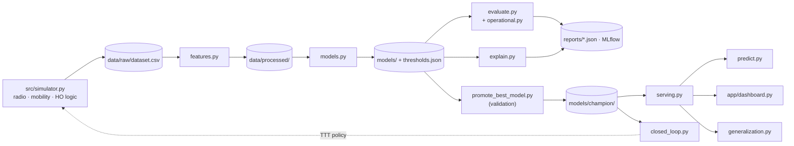

# Architecture

## System overview

A more detailed diagram, plus the handover state machine, feature and stacking diagrams, is in the [README](../README.md#system-architecture).

## Module responsibilities

### Simulation layer

| Module | Responsibility |
|--------|---------------|
| `src/simulator.py` | Shared step loop (measure → optional TTT policy → decide), two RNG streams (channel vs HO failure), RLF countdown and RRC re-establishment, `handover_soon` label, `make_simulator` |
| `src/radio_model.py` | UMa LOS/NLOS path loss, spatially consistent LOS, Gudmundson shadowing, measurement-averaged fast fading, **per-RE RSRP** with 3GPP reporting range, SINR (noise per RE), RSRQ, CQI |
| `src/mobility.py` | Random Waypoint with direction persistence; new cruise speed per leg; `current_speed` = actual speed |
| `src/handover_logic.py` | L3 filter, A3 + velocity-aware TTT (overridable per step), A3/A4/A5 tag, multi-factor failure probability, ping-pong hysteresis |
| `simulate.py` | Training run: 8 pedestrians + 7 vehicles, 3,600 s, seed 42 → `data/raw/dataset.csv` |
| `generate_test_dataset.py` | Scenario presets (`default`, `vehicle`, `stable`, `cell_edge`) on the shared engine; samples in `data/test_scenarios/` |

### Pipeline layer

| Module | Phase | Responsibility |
|--------|-------|---------------|
| `src/features.py` | 2 | `build_features` (per UE, index-preserving, warm-up flags), 83 observable features, temporal 70/15/15 split, scaler on train; `OnlineFeatureBuffer` for streaming |
| `src/models.py` | 3 | 6 learned models + rule baseline; one imbalance correction per model; PR-AUC early stopping; out-of-fold stacking; validation thresholds and metrics → `models/thresholds.json`; `score_sequence_model` (per-UE windows) |
| `src/evaluate.py` | 4 | Same test rows for every model; P/R/F1 at tuned threshold and 0.5, ROC-AUC, PR-AUC; ROC/PR/confusion plots; `evaluation.json` |
| `src/operational.py` | 4 | Event recall@3/5 s, lead time, false-alarm time share, operating curves, recall at a false-alarm budget → `operational.json` |
| `src/explain.py` | 5 | SHAP for LR, RF, XGBoost and the stacking meta-model |

### Experiments

| Module | Responsibility |
|--------|---------------|
| `src/closed_loop.py` | Champion inside the simulator's HO loop; predictive TTT policy vs baseline, always-short, always-long and a rate-matched random gate on unseen seeds |
| `src/generalization.py` | Champion vs rule on the 4 scenario presets and 3 unseen seeds through the serving path |

### Serving and MLOps

| Component | Role |
|-----------|------|
| `src/serving.py` | Single inference path: raw measurements → `build_features` → scaler → model → scores joined **by index**; warm-up rows not scored |
| `predict.py` | CLI on raw measurement CSVs / JSON rows, champion's tuned threshold by default |
| `app/dashboard.py` | Nine-tab Streamlit app (KPIs, HO timeline, risk, live prediction, model comparison with event metrics, SHAP, MLflow, mobility map, Proactive HO) |
| `scripts/promote_best_model.py` | Champion = max `0.6·val_F1 + 0.4·val_AUC` (validation only) → `models/champion/` |
| `dvc.yaml` | 8 stages: simulate → features → train → evaluate → explain → promote → generalize → closed_loop |
| `.github/workflows/ci.yml` | `tests` job (pytest) then `pipeline` job (`dvc repro`), reports uploaded as artifacts |
| `tests/` | 36 pytest tests: physics, HO logic, determinism, leakage, parity, serving invariances, event metrics |
| `mlflow.db` | SQLite tracking store; validation metrics at training, test metrics appended at evaluation |

## Key design decisions

**Two RNG streams in the simulator.** Mobility and channel randomness is separate from handover-failure draws. A TTT policy therefore changes decisions but never trajectories or fading, so the closed-loop comparison is paired (tested in `test_simulator.py`).

**Index-preserving features, one serving path.** `build_features` and `score_sequence_model` return results on the caller's index. Training, `predict.py`, the dashboard and the generalization study all go through `src/serving.py`. This fixed v3's 0-of-1500 `predict.py` bug and the dashboard row-misalignment bug, and `test_serving.py` guards both.

**Same rows for every model.** LSTM/GRU need a full `SEQ_LEN` window. Selection on validation and evaluation on test both use the rows that have one (`_build_seq_row_indices`), so all seven models are compared on identical data.

**Validation-only selection.** Thresholds (class-weighted models aren't calibrated) and the champion come from validation; the test split is read once. The stacking meta-model is trained on validation, so its validation score is out-of-fold.

**Time-based false-alarm cost.** A per-episode count rewards permanent alarms, so false alarms are measured as a share of time.

**L3 filter separation.** Raw and L3-filtered RSRP are both features. The handover state machine uses L3; the models see both, which separates instantaneous dips from sustained degradation.

**MLflow optional.** All MLflow calls are wrapped in `try/except`, and run IDs are recorded before artifact logging. sklearn models are logged with cloudpickle serialization (MLflow 3's skops default rejects tree objects).

**XGBoost float32.** All XGBoost inputs are cast to `float32`.
