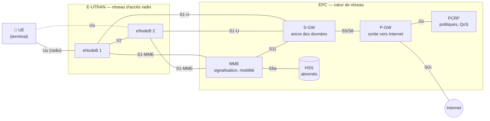
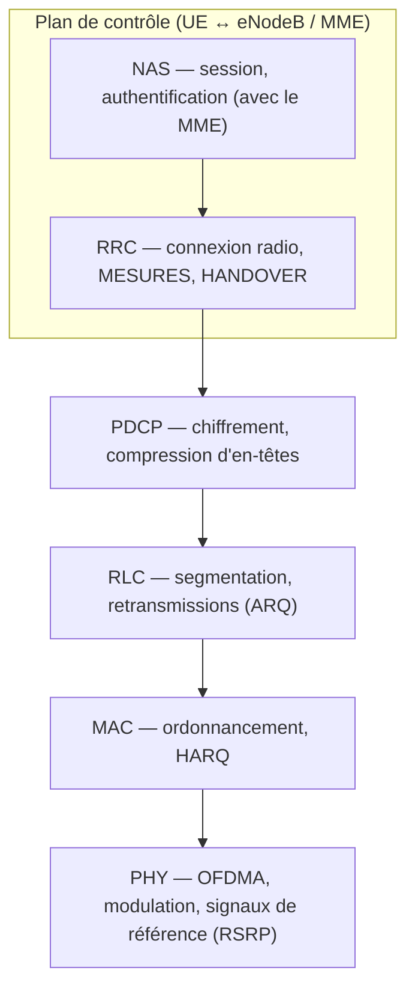

# Chapitre 1 — Réseaux mobiles et architecture LTE

> **Objectif du chapitre :** savoir expliquer, schéma à l'appui, comment est construit un réseau LTE, qui fait quoi, et où se situe le *handover* dans cette architecture.

---

## 1.1 Pourquoi un réseau « cellulaire » ?

Une antenne ne peut pas couvrir un pays entier : la puissance reçue décroît très vite avec la distance, et le spectre radio (les fréquences) est une ressource rare et chère. La solution, depuis la 1G, est de **découper le territoire en cellules** : chaque station de base couvre une petite zone et **réutilise les mêmes fréquences** que des cellules plus éloignées.

Cela crée immédiatement deux problèmes, qui sont au cœur de ce projet :

1. **L'interférence** : une cellule voisine qui émet sur la même fréquence perturbe le signal utile. C'est pour cela qu'on parle de **SINR** (rapport signal / interférence + bruit) et pas seulement de puissance reçue.
2. **La mobilité** : un utilisateur qui se déplace sort de sa cellule et doit être **transféré** vers une autre, sans couper sa communication. C'est le **handover** (en français : *transfert intercellulaire*).

## 1.2 Des générations successives (2G → 5G)

| Génération | Technologie principale | Ce qui change | Accès radio |
|---|---|---|---|
| 2G | GSM (1991) | voix numérique, SMS | TDMA/FDMA |
| 3G | UMTS / HSPA (2001) | données mobiles, Internet | WCDMA |
| **4G** | **LTE / LTE-Advanced (2009)** | **tout-IP, haut débit, faible latence** | **OFDMA (descendant), SC-FDMA (montant)** |
| 5G | NR (2019) | très haut débit, IoT massif, ultra-faible latence | OFDMA flexible (numérologies) |

**LTE** (*Long Term Evolution*, normes 3GPP à partir de la *Release 8*) est la technologie de ce projet. Deux idées le distinguent de la 3G :

- **tout-IP** : il n'y a plus de réseau « circuit » pour la voix ; tout est paquet IP (la voix passe en VoLTE) ;
- **OFDMA** : la bande est découpée en milliers de sous-porteuses étroites (15 kHz), ce qui résiste bien aux trajets multiples et permet d'allouer finement les ressources (chapitre 2).

> 💡 **Pourquoi LTE et pas 5G pour ce projet ?** LTE est massivement déployé, ses procédures de mesure et de handover (TS 36.331) sont stables et bien documentées, et la 5G NR reprend **les mêmes principes** (mesures RSRP/RSRQ/SINR, événements A3/A5, TTT). Tout ce qui est appris ici se transpose à la 5G.

## 1.3 L'architecture LTE (EPS)

Le système complet s'appelle **EPS** (*Evolved Packet System*). Il a deux grandes parties :

- **E-UTRAN** (le réseau d'accès radio) : uniquement des **eNodeB** (les stations de base) ;
- **EPC** (*Evolved Packet Core*, le cœur de réseau) : MME, S-GW, P-GW, HSS, PCRF.

### Rôle de chaque élément

| Élément | Rôle | Analogie |
|---|---|---|
| **UE** (*User Equipment*) | le terminal ; il **mesure** la qualité radio des cellules et la rapporte | le passager |
| **eNodeB** | station de base : gère la radio, **ordonnance** les ressources, **décide les handovers** | le contrôleur local |
| **MME** (*Mobility Management Entity*) | plan de contrôle : authentification, suivi de localisation, établissement des sessions, signalisation des handovers S1 | le centre de régulation |
| **S-GW** (*Serving Gateway*) | achemine les paquets de l'utilisateur ; **ancre de mobilité** entre eNodeB | l'aiguillage |
| **P-GW** (*PDN Gateway*) | sortie vers Internet, attribution de l'adresse IP, facturation | la frontière |
| **HSS** (*Home Subscriber Server*) | base de données des abonnés (clés, profils) | l'annuaire |
| **PCRF** | règles de qualité de service et de facturation | le règlement |

### Les interfaces à connaître

- **Uu** : l'interface radio entre UE et eNodeB (c'est là que se font les **mesures**).
- **X2** : liaison **directe entre deux eNodeB**. Elle sert au **handover X2** (le plus courant) et à la coordination d'interférences.
- **S1** : entre eNodeB et cœur. **S1-MME** pour la signalisation (plan de contrôle), **S1-U** pour les données (plan utilisateur).

> 🎯 **Point clé pour l'entretien :** en LTE, **c'est l'eNodeB source qui décide du handover**, sur la base des **rapports de mesure** envoyés par l'UE. Il n'y a plus de contrôleur centralisé comme le RNC de la 3G : l'architecture est « plate ». C'est exactement pour cela qu'un modèle prédictif déployé **au niveau de l'eNodeB** (ou d'un contrôleur SON) est pertinent.

## 1.4 Plan de contrôle et plan utilisateur

Tout trafic dans le réseau appartient à l'un de deux plans :

- **Plan utilisateur (U-plane)** : les données de l'utilisateur (vidéo, web…). Chemin : UE → eNodeB → S-GW → P-GW → Internet.
- **Plan de contrôle (C-plane)** : la **signalisation** qui pilote le réseau (connexion, mesures, handover). Chemin : UE → eNodeB (RRC) → MME (NAS).

Le handover est avant tout une **procédure du plan de contrôle** (messages RRC et X2AP), qui a des **conséquences sur le plan utilisateur** (les paquets doivent être redirigés vers la nouvelle cellule sans perte).

## 1.5 La pile protocolaire radio

| Couche | Ce qu'elle fait | Lien avec le projet |
|---|---|---|
| **PHY** (couche 1) | transmission OFDMA, signaux de référence, mesures physiques | le **RSRP** est mesuré ici sur les signaux de référence |
| **MAC** | ordonnancement des ressources, HARQ | utilise le **CQI** pour choisir la modulation |
| **RLC / PDCP** | fiabilité, chiffrement | transfert des paquets en cours lors d'un handover |
| **RRC** (couche 3) | gestion de la connexion radio | **configure les mesures**, reçoit les **rapports**, envoie l'**ordre de handover** ; applique le **filtrage L3** |

> 💡 **« L1 » et « L3 »** dans le code (`l3_rsrp_serving`) font référence à ces couches : la mesure brute est faite en couche 1 (PHY), puis **lissée par un filtre en couche 3** (RRC) avant d'être comparée aux seuils de handover.

## 1.6 Les états RRC : où a lieu le handover ?

Un UE est toujours dans l'un de deux états :

| État | Situation | Mobilité |
|---|---|---|
| **RRC_IDLE** | pas de communication active (téléphone en veille) | **resélection de cellule** décidée par l'UE lui-même, sans signalisation |
| **RRC_CONNECTED** | communication active | **handover** décidé par le réseau (eNodeB), sur la base des mesures de l'UE |

**Ce projet traite le handover en RRC_CONNECTED** : c'est là qu'un handover raté coupe une communication (perte d'appel, coupure de vidéo) et qu'une prédiction a de la valeur.

## 1.7 Ce qu'il faut retenir

- Un réseau cellulaire réutilise les fréquences → **interférence** et **mobilité** sont les deux problèmes fondamentaux.
- LTE = **E-UTRAN** (eNodeB) + **EPC** (MME, S-GW, P-GW, HSS, PCRF) ; architecture **plate**, tout-IP.
- Les eNodeB communiquent directement par **X2** ; c'est le chemin du handover le plus courant.
- **L'eNodeB source décide le handover** à partir des **rapports de mesure RRC** de l'UE.
- Le projet se place en **RRC_CONNECTED**, sur la mobilité **intra-LTE, intra-fréquence**.

➡️ Chapitre suivant : [la couche physique et la propagation radio](02_couche_physique_et_propagation.md)
