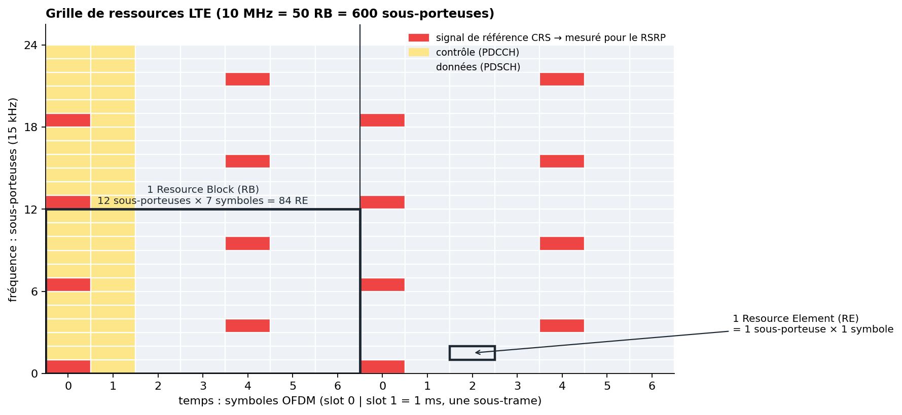
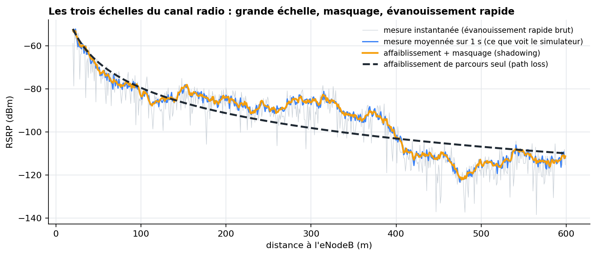
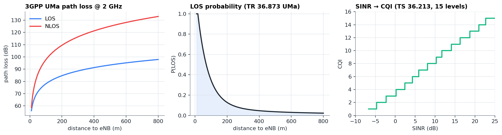
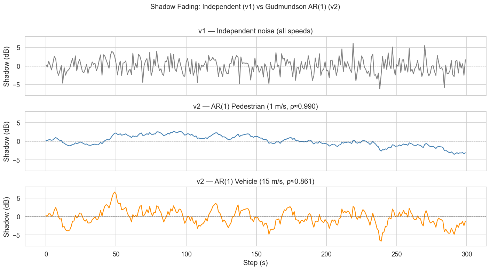

# Chapitre 2 — Couche physique et propagation radio

> **Objectif :** comprendre d'où viennent les nombres que le modèle reçoit en entrée. Pourquoi le signal varie, à quelles échelles, et comment le simulateur reproduit ces variations.

---

## 2.1 Les décibels : l'outil indispensable

En radio, les puissances couvrent des dizaines d'ordres de grandeur (de 40 W à l'antenne à 10⁻¹⁴ W au terminal). On les exprime donc en **échelle logarithmique** :

- **dB** : un *rapport* de puissances. $G_{dB} = 10 \log_{10}(P_1 / P_2)$. Exemple : ×2 ≈ +3 dB, ×10 = +10 dB, ×1000 = +30 dB.
- **dBm** : une *puissance absolue*, rapportée à 1 mW. $P_{dBm} = 10 \log_{10}(P / 1\,\text{mW})$. Exemple : 1 W = 30 dBm, 40 W ≈ 46 dBm, 1 pW = −90 dBm.

Règles à connaître par cœur :

| Opération en linéaire | Équivalent en dB |
|---|---|
| multiplier par un gain | **additionner** des dB |
| diviser (perte) | **soustraire** des dB |
| additionner deux puissances | **pas** une addition en dB : il faut repasser en linéaire (mW), sommer, revenir en dB |

> ⚠️ Le troisième point est un piège classique : deux signaux de −100 dBm donnent −97 dBm, pas −200 dBm. Le code du simulateur repasse toujours en mW avant de sommer (`compute_sinr`, `compute_rsrq`).

## 2.2 OFDMA et la grille de ressources

LTE découpe la bande en **sous-porteuses** de 15 kHz, orthogonales entre elles (OFDM). Dans le temps, le signal est découpé en **symboles OFDM** (≈ 71 µs). La plus petite unité est donc une case de cette grille :

- **Resource Element (RE)** : 1 sous-porteuse × 1 symbole ;
- **Resource Block (RB)** : 12 sous-porteuses (180 kHz) × 7 symboles (un *slot* de 0,5 ms), soit 84 RE. C'est l'unité que l'ordonnanceur attribue aux utilisateurs.

| Largeur de bande | Nombre de RB | Sous-porteuses utiles |
|---|---|---|
| 1,4 MHz | 6 | 72 |
| 5 MHz | 25 | 300 |
| **10 MHz (projet)** | **50** | **600** |
| 20 MHz | 100 | 1200 |

Parmi ces RE, certains portent des **signaux de référence** (*Cell-specific Reference Signals*, CRS), en rouge ci-dessus. Leur position et leur puissance sont connues à l'avance : le terminal les utilise pour **estimer le canal** et **mesurer la qualité de chaque cellule**. C'est sur ces RE précis qu'est défini le **RSRP** (chapitre 3).

> 🎯 **Conséquence directe dans le projet :** l'eNodeB émet 46 dBm (≈ 40 W) **au total**, répartis sur 600 sous-porteuses. Un seul RE reçoit donc 46 − 10·log₁₀(600) ≈ **18,2 dBm**. Le RSRP doit être calculé à partir de cette puissance *par RE*. La version 3 du simulateur utilisait les 46 dBm entiers : tous les RSRP étaient trop élevés de 27,8 dB, et 20 % des valeurs dépassaient le maximum reportable de −44 dBm. La v4 corrige cela (`RadioConfig.rs_power_dbm`).

## 2.3 Les trois échelles du canal radio

Le signal reçu par un terminal varie pour trois raisons physiques différentes, à trois échelles différentes :

| Phénomène | Cause | Échelle spatiale | Amplitude typique | Dans le simulateur |
|---|---|---|---|---|
| **Affaiblissement de parcours** (*path loss*) | la puissance se dilue avec la distance | des centaines de m | 60 à 140 dB | `path_loss_los` / `path_loss_nlos` |
| **Masquage** (*shadowing*) | bâtiments, relief qui masquent le trajet | ~50 à 100 m | σ = 4 à 8 dB | `update_shadow` (Gudmundson) |
| **Évanouissement rapide** (*fast fading*) | trajets multiples qui s'additionnent ou s'annulent | λ/2 ≈ 7,5 cm à 2 GHz | jusqu'à −30 dB instantané | `update_fast_fading` (moyenné sur 1 s) |

### a) Affaiblissement de parcours : le modèle 3GPP UMa

En espace libre (formule de Friis), la puissance décroît en $1/d^2$, soit −20 dB par décade de distance. En ville, avec les réflexions sur le sol et les bâtiments, la décroissance est plus rapide, typiquement $1/d^{3,5}$ à $1/d^4$.

Le projet utilise le modèle **3GPP TR 36.873 UMa** (*Urban Macro* : antennes sur les toits, ville dense), avec deux formules selon que le trajet direct existe ou non :

$$PL_{LOS} = 22\log_{10}(d) + 28 + 20\log_{10}(f_c) \qquad PL_{NLOS} = \max\big(PL_{LOS},\ 19{,}55 + 39{,}09\log_{10}(d)\big)$$

avec $d$ en mètres et $f_c$ en GHz (2 GHz ici). La pente NLOS (39 dB/décade) est presque le double de la pente LOS (22 dB/décade).

### b) LOS ou NLOS ? Une probabilité qui dépend de la distance

Le trajet direct (LOS, *line of sight*) existe-t-il entre l'antenne et le terminal ? Près de l'antenne, souvent ; loin, rarement. 3GPP donne :

$$P(LOS \mid d) = \min\left(\frac{18}{d}, 1\right)\left(1 - e^{-d/63}\right) + e^{-d/63}$$

Soit environ 65 % à 50 m, 35 % à 100 m, 13 % à 200 m, 5 % à 400 m.

**Cohérence spatiale (v4).** Il ne suffit pas de tirer LOS/NLOS au hasard : un piéton immobile ne doit pas basculer. La v3 retirait l'état toutes les 5 secondes, indépendamment du déplacement, ce qui provoquait des sauts de ~20 dB même pour un terminal à l'arrêt, et des handovers en cascade. La v4 suit la procédure de cohérence spatiale de **TR 38.901** : un processus gaussien latent $z$ évolue avec la distance parcourue ($\rho = e^{-\Delta d / 50\,\text{m}}$), et le lien est LOS si $\Phi(z) < P(LOS \mid d)$. La probabilité marginale reste exacte, et l'état ne change que si l'UE bouge.

### c) Masquage (shadowing) : le modèle de Gudmundson

Le masquage suit une loi **log-normale** : en dB, c'est une gaussienne d'écart-type σ (4 dB en LOS, 6 dB en NLOS). Il est **corrélé dans l'espace** : deux points distants de quelques mètres ont presque le même masquage. Le modèle de Gudmundson l'exprime comme un processus AR(1) sur la distance :

$$S_{n} = \rho\, S_{n-1} + \sqrt{1-\rho^2}\ \mathcal{N}(0, \sigma^2), \qquad \rho = e^{-\Delta d / d_{corr}},\ d_{corr} = 100\ \text{m}$$

*Sortie du notebook 06. En haut, un masquage tiré indépendamment à chaque seconde (irréaliste : le terrain ne change pas d'une seconde à l'autre). Au milieu et en bas, le modèle de Gudmundson : pour un piéton (1 m/s) la corrélation d'un pas à l'autre est ρ ≈ 0,99 et le masquage dérive lentement ; pour un véhicule (15 m/s), ρ ≈ 0,86 et il varie plus vite.*

### d) Évanouissement rapide : Rayleigh, Rice et moyennage

Le signal arrive par de nombreux trajets (réflexions, diffractions) qui s'additionnent avec des phases différentes. Sans trajet direct, l'amplitude suit une loi de **Rayleigh** ; avec un trajet direct dominant, une loi de **Rice** (facteur K = 5 dB dans le projet). Ces évanouissements varient **toutes les demi-longueurs d'onde** : à 2 GHz, λ = c/f = 15 cm, donc tous les 7,5 cm.

Un terminal ne rapporte pas une valeur instantanée : il **moyenne** sur une période de mesure. Sur 1 s, un piéton à 1 m/s traverse ~14 zones indépendantes et un véhicule à 15 m/s ~200. La moyenne de $N$ échantillons indépendants a une dispersion réduite d'un facteur ~√N. C'est ce que fait la v4 : environ 1,2 dB d'écart-type pour un piéton, 0,3 dB pour un véhicule, au lieu des ±5 dB d'un échantillon unique.

> 💡 **Pourquoi c'est important pour le ML :** si l'on simule mal ces échelles, le modèle apprend des artefacts. Avec un évanouissement non moyenné, il apprendrait à « prédire » des handovers déclenchés par du bruit, ce qui n'existe pas dans un vrai réseau.

## 2.4 Bruit, interférence et SINR

Le signal utile n'est pas seul : il y a du **bruit thermique** et l'**interférence** des cellules voisines qui réutilisent la même fréquence.

**Bruit thermique.** $N = kTB$ : −174 dBm/Hz à température ambiante. Sur les 9 MHz réellement occupés par 50 RB, cela fait −174 + 10·log₁₀(9·10⁶) ≈ −104,5 dBm. On ajoute le **facteur de bruit** du récepteur (~9 dB pour un terminal), soit **N ≈ −95,5 dBm**.

**Interférence.** Chaque cellule voisine $k$ contribue en proportion de sa charge : une cellule vide n'émet que ses signaux de référence (~10 % du temps-fréquence), une cellule pleine émet partout.

$$SINR = \frac{S}{\sum_k P_k \cdot \big(0{,}1 + 0{,}9 \cdot \text{charge}_k\big) + N}$$

Dans le projet (4 cellules espacées de 500 m), le réseau est **limité par l'interférence** : l'interférence dépasse largement le bruit presque partout. Le SINR est donc surtout déterminé par le **rapport entre la cellule de service et les voisines**, ce qui en fait un excellent indicateur de proximité de la frontière de cellule.

> 🎯 **Question classique :** « Pourquoi le SINR baisse-t-il avant un handover ? » Parce qu'en approchant de la frontière, le signal de la cellule de service baisse **et** celui de la voisine (qui est de l'interférence !) monte. Le SINR chute donc doublement. C'est l'une des raisons pour lesquelles un handover tardif échoue souvent : au moment de l'exécution, le SINR est trop faible pour que les messages de signalisation passent.

## 2.5 Ce qu'il faut retenir

- Les puissances s'additionnent en **mW**, pas en dB.
- LTE 10 MHz = **50 RB = 600 sous-porteuses** ; le RSRP se mesure **par RE**, sur les signaux de référence.
- Trois échelles de variation : **path loss** (distance), **shadowing** (obstacles, ~100 m), **fast fading** (λ/2, moyenné par la mesure).
- LOS/NLOS selon 3GPP, avec **cohérence spatiale** (v4).
- SINR = signal / (interférence pondérée par la charge + bruit). Le réseau du projet est **limité par l'interférence**.

⬅️ [Chapitre 1](01_reseaux_mobiles_et_lte.md) · ➡️ [Chapitre 3 — les KPI radio](03_kpi_radio.md)
