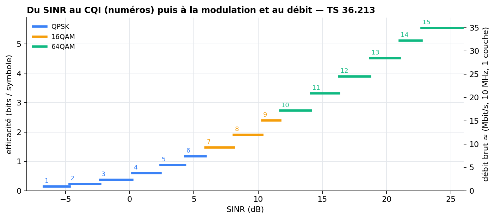

# Chapitre 3 — Les indicateurs radio (KPI) : RSRP, RSRQ, SINR, CQI

> **Objectif :** savoir définir précisément chaque KPI utilisé par le modèle, donner ses ordres de grandeur, et surtout **justifier pourquoi ce sont ces indicateurs-là qui servent à prédire un handover**, et pas d'autres.

---

## 3.1 Vue d'ensemble

| KPI | Ce qu'il mesure | Unité / plage | Qui le mesure | Colonne du dataset |
|---|---|---|---|---|
| **RSRP** | la **puissance** reçue d'une cellule | dBm, −140 à −44 | l'UE, sur les signaux de référence | `rsrp_serving`, `rsrp_neighbor` |
| **RSRQ** | la **qualité** : part de la cellule dans tout ce qui est reçu | dB, −19,5 à −3 | l'UE | `rsrq_serving`, `rsrq_neighbor` |
| **SINR** | signal / (interférence + bruit) | dB, ≈ −20 à +30 | l'UE (non standardisé en LTE) | `sinr` |
| **CQI** | qualité de canal **résumée en un indice** pour l'ordonnanceur | 1 à 15 | l'UE, envoyé à l'eNodeB | `cqi` |
| RSRP filtré L3 | RSRP lissé par la couche RRC | dBm | l'UE (filtre RRC) | `l3_rsrp_serving`, `l3_rsrp_neighbor` |

## 3.2 RSRP — *Reference Signal Received Power*

**Définition (3GPP TS 36.214).** Moyenne linéaire de la puissance reçue sur les **Resource Elements qui portent les signaux de référence (CRS)** d'une cellule, dans la bande de mesure.

C'est donc la puissance **d'un seul RE**, et pas la puissance totale. Cela rend le RSRP **indépendant de la largeur de bande et de la charge** de la cellule : il ne dépend que de la **distance et du canal** entre l'UE et l'antenne. C'est exactement ce qu'on veut pour comparer des cellules entre elles.

**Plage de rapport (TS 36.133) :** de −140 dBm à −44 dBm, par pas de 1 dB (valeurs RSRP_00 à RSRP_97). Une valeur au-dessus de −44 dBm est rapportée « −44 ».

**Ordres de grandeur (usage terrain courant) :**

| RSRP | Qualité |
|---|---|
| > −80 dBm | excellente (près de l'antenne) |
| −80 à −90 dBm | bonne |
| −90 à −100 dBm | moyenne |
| −100 à −110 dBm | faible (bord de cellule) |
| < −110 dBm | très faible, risque de perte de lien |

**Exemple chiffré du projet.** eNodeB 46 dBm au total → 18,2 dBm par RE. À 300 m en NLOS : $PL = 19{,}55 + 39{,}09 \log_{10}(300) \approx 116{,}4$ dB → RSRP ≈ 18,2 − 116,4 ≈ **−98 dBm** avant masquage, typique d'une zone de bord de cellule en ville.

> 🎯 **Pourquoi le RSRP est le KPI n°1 du handover :** l'événement A3 (chapitre 4), qui déclenche la grande majorité des handovers, compare **le RSRP de la voisine à celui de la cellule de service**. Le modèle reçoit donc directement la grandeur qui pilote la décision.

## 3.3 RSRQ — *Reference Signal Received Quality*

**Définition :**

$$RSRQ = N \cdot \frac{RSRP}{RSSI}$$

- **RSSI** (*Received Signal Strength Indicator*) : **toute** la puissance reçue sur la bande (signal utile + interférence de toutes les cellules + bruit) ;
- $N$ : nombre de RB de la bande de mesure (il normalise le rapport).

Le RSRQ dit donc **quelle part de ce que je reçois vient de ma cellule**. Plage : −19,5 à −3 dB. Au-dessus de −10 dB c'est bon ; en dessous de −15 dB la qualité est mauvaise.

**Différence clé avec le RSRP :** deux UE peuvent avoir le même RSRP de −95 dBm, l'un dans une zone calme (RSRQ −8 dB) et l'autre noyé dans l'interférence (RSRQ −17 dB). Le RSRQ voit la **charge et l'interférence**, le RSRP non.

> 🔧 **Simplification du simulateur :** le projet calcule RSRQ ≈ RSRP_service / Σ RSRP_toutes cellules (en mW), c'est-à-dire la part de la cellule dans la puissance reçue des 4 cellules, bornée à [−20, −3] dB. Ni la charge ni le facteur N ne sont modélisés exactement. Le RSRQ reste corrélé à la proximité de la frontière, ce qui est l'usage qu'en fait le modèle.

## 3.4 SINR — *Signal to Interference plus Noise Ratio*

$$SINR = \frac{S}{I + N}$$

C'est la grandeur physique qui détermine **combien de bits on peut transmettre** (théorème de Shannon : $C = B \log_2(1 + SINR)$). En LTE, le SINR n'est pas un rapport de mesure standardisé (il le devient en 5G NR avec le SS-SINR), mais tous les terminaux l'estiment en interne pour calculer le CQI.

| SINR | Qualité |
|---|---|
| > 20 dB | excellente |
| 13 à 20 dB | bonne |
| 0 à 13 dB | moyenne |
| < 0 dB | mauvaise (l'interférence domine) |

Dans le simulateur, le SINR est calculé à partir des **RSRP filtrés L3** (comme un terminal réel qui moyenne ses estimations), avec une interférence pondérée par la charge de chaque voisine (chapitre 2). Pendant une **RLF** (*radio link failure*), il est forcé à −15 dB.

## 3.5 CQI — *Channel Quality Indicator*

Le CQI est un **entier de 1 à 15** que l'UE renvoie à l'eNodeB. Il signifie : « avec ce canal, voici le schéma de modulation et de codage le plus efficace que je peux décoder avec moins de 10 % d'erreurs de bloc ». L'ordonnanceur (couche MAC) s'en sert pour choisir la **modulation (QPSK, 16QAM, 64QAM)** et le **taux de codage**, donc le débit. C'est l'**adaptation de lien**.

Le CQI est une **version quantifiée du SINR** (table de TS 36.213). Il apporte peu d'information en plus du SINR, mais il est disponible côté réseau sans calcul. Le modèle l'utilise donc comme une variable de plus.

## 3.6 Pourquoi ces KPI, et pas d'autres ?

C'est une question d'entretien très probable. Quatre critères justifient le choix.

**1. Ils sont disponibles là où la décision est prise, en temps réel.** L'eNodeB reçoit les **rapports de mesure RRC** (*Measurement Reports*) qui contiennent le RSRP et le RSRQ de la cellule de service et des voisines. Il reçoit aussi le CQI en continu. Un modèle déployé dans l'eNodeB (ou un contrôleur SON/RIC) a donc accès à ces valeurs **sans rien changer au terminal ni à la norme**.

**2. Ils sont standardisés.** Leur définition est la même chez tous les constructeurs (TS 36.214, 36.133). Un modèle entraîné sur ces grandeurs est transposable d'un réseau à l'autre, ce qui n'est pas le cas d'un compteur propriétaire.

**3. Ce sont des précurseurs physiques du handover.** Le handover est déclenché par une comparaison de RSRP (événement A3). Avant ce déclenchement, le RSRP de service baisse, celui de la voisine monte, le SINR chute. Les KPI radio **précèdent causalement** l'événement à prédire.

**4. Leur dynamique est informative.** Ce n'est pas seulement la valeur, mais la **tendance** (le RSRP baisse-t-il de 2 dB/s ?) qui annonce un handover. D'où les variables de retard (*lags*), de moyennes glissantes et de dérivées (*deltas*) du chapitre 6.

### Et les autres indicateurs ?

| Indicateur | Pourquoi il n'est pas utilisé comme entrée |
|---|---|
| **Débit** (Mbit/s) | dépend du trafic de l'utilisateur et de l'ordonnanceur : un utilisateur qui ne télécharge rien a un débit nul même avec un excellent canal. Il **suit** la qualité radio avec retard. |
| **Latence, gigue** | indicateurs de bout en bout, influencés par tout le réseau (cœur, Internet), pas par la position radio. |
| **BLER** (taux d'erreurs de bloc) | volontairement maintenu autour de 10 % par l'adaptation de lien : il reste stable tant que le lien tient. |
| **Position GPS** (`pos_x`, `pos_y`) | **non disponible** pour le réseau en temps réel (confidentialité, batterie, précision en intérieur). Le simulateur la connaît, mais l'utiliser serait **tricher**. La v4 l'a retirée des entrées. |
| **État LOS/NLOS** (`los_flag`) | grandeur cachée : aucun équipement ne la mesure directement. Retirée des entrées pour la même raison. |
| **Timing Advance** | indique la distance à l'antenne de service, mais pas la position par rapport aux voisines. Possible extension. |

> 🎯 **Phrase à retenir :** « J'utilise uniquement des grandeurs que l'eNodeB reçoit déjà dans les rapports de mesure standardisés. Le modèle est donc déployable sans modifier le terminal ni la norme. J'ai d'ailleurs retiré la position et l'état LOS, que le simulateur connaît mais qu'un vrai réseau n'observe pas. Mesuré sur la v3 du projet, ce retrait ne coûtait qu'environ 0,01 de F1. »

## 3.7 La vitesse et la charge

Deux variables de contexte complètent les KPI radio :

- `ue_speed` : la vitesse réelle du terminal (0 quand il est à l'arrêt). Un réseau peut l'estimer (effet Doppler, fréquence des handovers, *mobility state estimation* de la norme). Elle influence le TTT (chapitre 4) et la probabilité d'échec.
- `cell_load_pct` : la charge de la cellule de service (UE servis / capacité). Elle est connue de l'eNodeB et module l'interférence.
- `rsrp_diff` : RSRP service − RSRP meilleure voisine. C'est la grandeur la plus directement liée à A3, calculée à partir des deux RSRP.

## 3.8 Ce qu'il faut retenir

- **RSRP** = puissance d'un RE de référence : mesure de **couverture**, indépendante de la charge. C'est la grandeur d'A3.
- **RSRQ** = part de la cellule dans tout le reçu : mesure de **qualité**, sensible à l'interférence.
- **SINR** = rapport utile/nuisible qui détermine le débit ; il **s'effondre en bord de cellule**.
- **CQI** = SINR quantifié pour l'adaptation de lien.
- Ces KPI sont choisis parce qu'ils sont **disponibles, standardisés, précurseurs causaux** du handover, et informatifs par leur **dynamique**.

⬅️ [Chapitre 2](02_couche_physique_et_propagation.md) · ➡️ [Chapitre 4 — mobilité et handover](04_mobilite_et_handover.md)
