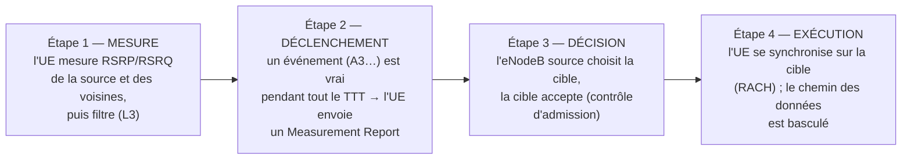
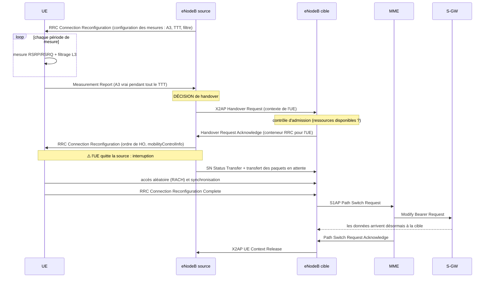
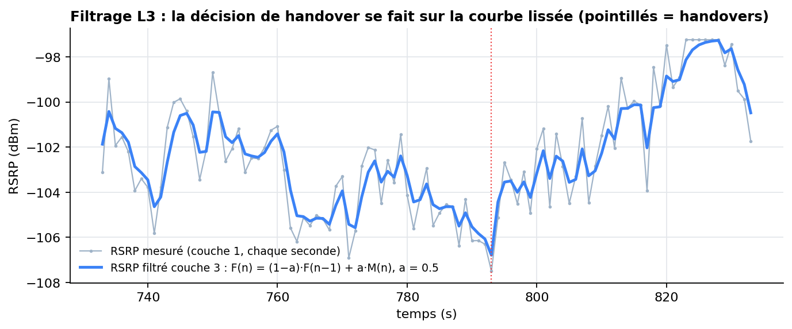
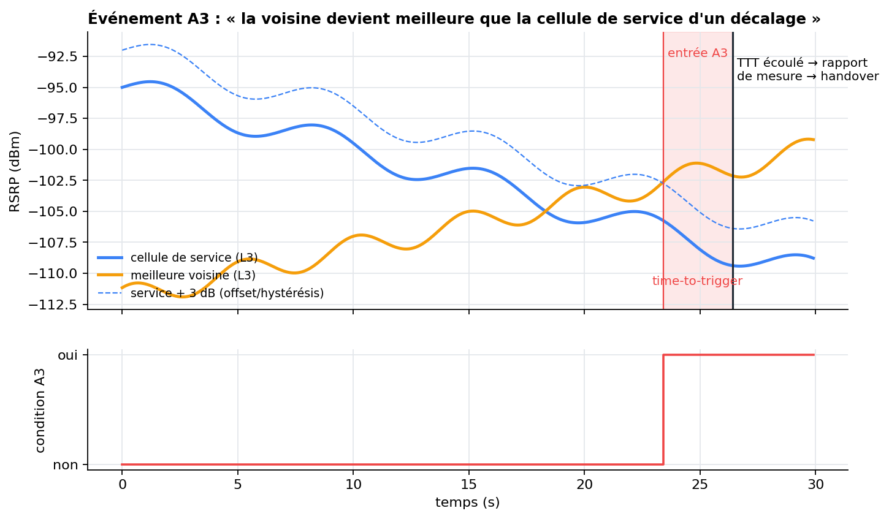

# Chapitre 4 — Mobilité et handover en LTE

> **Objectif :** savoir dérouler la procédure de handover de bout en bout (mesure, déclenchement, décision, exécution), connaître les événements de mesure et les paramètres (offset, hystérésis, TTT), et comprendre les échecs que le projet cherche à anticiper.

---

## 4.1 Qu'est-ce qu'un handover ?

Un **handover** (HO, *transfert intercellulaire*) est le transfert d'une communication en cours d'une cellule (la **source**, ou *serving*) vers une autre (la **cible**, ou *target*), parce que la cible offre désormais une meilleure liaison radio.

En LTE, le handover est **« dur »** (*hard handover*, *break-before-make*) : l'UE coupe la liaison avec la source **avant** d'établir celle avec la cible. L'interruption dure quelques dizaines de millisecondes si tout se passe bien. S'il échoue, l'UE perd la liaison (**RLF**) et doit se reconnecter, ce qui coupe la communication pendant une à plusieurs secondes.

### Les types de handover

| Type | Entre | Chemin de signalisation | Dans le projet |
|---|---|---|---|
| **Intra-LTE, intra-fréquence, X2** | deux eNodeB voisins, même fréquence | direct par **X2** | ✅ c'est le cas modélisé |
| Intra-LTE, S1 | deux eNodeB sans liaison X2 | via le **MME** (S1) | — |
| Inter-fréquence | deux fréquences LTE | mesures en *gaps* | — |
| Inter-RAT | LTE ↔ 3G/2G/5G | via les cœurs de réseau | — |

## 4.2 Les quatre étapes d'un handover

**Le projet intervient entre l'étape 1 et l'étape 2 :** il prédit, à partir des mesures, qu'un handover réussi aura lieu dans les 3 prochaines secondes, **avant** que l'événement ne se déclenche.

## 4.3 La procédure X2 en détail

**Ce qui prend du temps et peut échouer :**

- entre le *Measurement Report* et l'ordre de handover, il faut l'échange X2 et le contrôle d'admission (quelques dizaines de ms) ;
- l'**ordre de handover** est envoyé **par la source**, au moment où le lien avec elle se dégrade. Si le SINR est trop bas, l'UE ne le reçoit jamais : c'est le **handover trop tardif** ;
- l'accès à la cible (RACH) peut échouer si la cible est encore trop faible : c'est le **handover trop précoce**.

> 🎯 **D'où l'intérêt de la prédiction :** si l'eNodeB sait **3 secondes à l'avance** qu'un handover va avoir lieu, il peut **préparer la cible** (réserver des ressources, transférer le contexte), ou **avancer** le handover pendant que le SINR est encore bon. C'est exactement ce que teste l'expérience en boucle fermée du chapitre 9.

## 4.4 Le filtrage de couche 3

Les mesures brutes (couche 1) sont très bruitées. Avant de les comparer aux seuils, la couche RRC applique un **filtre exponentiel** (TS 36.331, §5.5.3.2) :

$$F_n = (1 - a)\, F_{n-1} + a\, M_n \qquad a = \frac{1}{2^{k/4}}$$

où $M_n$ est la dernière mesure, $F_n$ la valeur filtrée et $k$ le *filterCoefficient* configuré par le réseau. **La valeur par défaut $k = 4$ donne $a = 0{,}5$**, celle du projet (`HOConfig.l3_alpha = 0.5`).

Un $a$ petit (k grand) lisse beaucoup : moins de faux déclenchements, mais une réaction plus lente. C'est le premier compromis réactivité / stabilité de la mobilité.

## 4.5 Les événements de mesure

Le réseau configure **quand** l'UE doit envoyer un rapport, sous forme d'**événements** (TS 36.331, §5.5.4). « Serving » est la cellule de service ; « Neighbour » une voisine.

| Événement | Condition d'entrée (simplifiée) | Usage typique |
|---|---|---|
| **A1** | Serving devient meilleure qu'un seuil | arrêter les mesures inter-fréquence |
| **A2** | Serving devient pire qu'un seuil | démarrer les mesures inter-fréquence |
| **A3** | **Neighbour devient meilleure que Serving + offset** | **handover intra-fréquence (le plus courant)** |
| **A4** | Neighbour devient meilleure qu'un seuil | handover vers une couche de capacité |
| **A5** | Serving pire que seuil 1 **et** Neighbour meilleure que seuil 2 | handover de couverture (bord de cellule) |
| A6 | Neighbour meilleure qu'une SCell + offset | agrégation de porteuses |
| B1 / B2 | équivalents d'A4 / A5 vers une autre technologie | handover inter-RAT |

### L'événement A3 en détail

La condition complète est :

$$M_n + O_{fn} + O_{cn} - Hys > M_p + O_{fp} + O_{cp} + Off$$

- $M_n$, $M_p$ : mesures filtrées (RSRP) de la voisine et de la cellule de service ;
- $O_{f}$, $O_{c}$ : décalages par fréquence et par cellule (*Cell Individual Offset*, CIO). Le CIO permet d'**avancer ou retarder** les handovers vers une voisine précise ;
- $Hys$ : **hystérésis**, pour éviter les allers-retours ;
- $Off$ : **offset** A3.

La condition doit rester vraie pendant tout le **Time-To-Trigger (TTT)** pour que le rapport soit envoyé. Valeurs normalisées du TTT : 0, 40, 64, 80, 100, 128, 160, 256, 320, 480, 512, 640, 1024, 1280, 2560, 5120 ms.

**Dans le projet** (`src/handover_logic.py`) : offset et hystérésis sont regroupés en une **marge de 3 dB** (`ho_margin_db`), et la comparaison se fait sur les **RSRP filtrés L3**. Le pas de temps est d'une seconde, donc le TTT est compté en secondes (1 à 3 s, plus grossier que la réalité).

### TTT adapté à la vitesse

Un véhicule rapide traverse la zone de recouvrement en quelques secondes : un TTT long le ferait partir trop tard. La norme prévoit des **états de mobilité** (*normal / medium / high*), estimés d'après le nombre de handovers récents, qui **multiplient le TTT par un facteur de réduction** (*speed-dependent scaling*, sf-Medium, sf-High). Le projet reproduit cette idée avec une formule continue :

$$TTT = \max\left(1,\ 3 - \left\lfloor \frac{v}{7} \right\rfloor\right) \text{ secondes}$$

Soit 3 s pour un piéton, 2 s entre 7 et 14 m/s, et 1 s au-delà de 14 m/s.

### Et A4 / A5 dans le projet ?

> ⚠️ **Nuance importante, à dire honnêtement si on vous le demande.** Dans le simulateur, **seul A3 déclenche** le handover. Quand le TTT expire, la logique **qualifie** l'événement selon la condition dominante : « A5 » si la source est sous −96 dBm et la voisine au-dessus de −88 dBm, « A4 » si la voisine dépasse −83 dBm, « A3 » sinon. La colonne `event_type` est donc une **étiquette descriptive** (handover de couverture, vers une cellule forte, ou relatif), pas un déclencheur indépendant. Dans un vrai réseau, A4 et A5 sont configurés comme des déclencheurs à part entière.

## 4.6 Quand le handover échoue

### La RLF (*Radio Link Failure*)

L'UE surveille la qualité de son lien. Après **N310** indications consécutives de « hors synchronisation », il lance un temporisateur **T310**. Si le lien ne se rétablit pas avant son expiration, il déclare une **RLF**, puis tente un **RRC Connection Re-establishment** vers la meilleure cellule qu'il trouve. Pendant ce temps, la communication est coupée.

**Dans le projet :** un handover échoue avec une probabilité qui combine quatre facteurs (figure ci-dessous) : SINR au moment du handover (poids 50 %), vitesse (15 %), RSRP de la cible (15 %) et temps déjà passé à très faible RSRP (20 %). En cas d'échec, l'UE passe **exactement 3 s en RLF** (SINR forcé à −15 dB, aucun handover possible), puis **se rétablit sur la cellule la plus forte** (colonne `rrc_reestablish`). La v3 avait une RLF de 2 s par erreur et laissait l'UE sur la cellule défaillante ; la v4 corrige les deux.

### Les quatre types de problèmes de mobilité

| Problème | Ce qui se passe | Cause | Remède |
|---|---|---|---|
| **Trop tardif** (*too late*) | RLF dans la source **avant ou pendant** le handover | la condition est atteinte trop tard (TTT/offset trop grands, UE rapide) | avancer : réduire TTT/offset, augmenter le CIO de la cible |
| **Trop précoce** (*too early*) | RLF juste **après** le handover, rétablissement dans la source | la cible n'était pas encore assez forte | retarder : augmenter TTT/offset |
| **Mauvaise cellule** | RLF après handover, rétablissement dans une **troisième** cellule | mauvais choix de cible | ajuster les CIO |
| **Ping-pong** | handover A → B puis retour B → A en quelques secondes | fluctuations autour de la frontière | augmenter hystérésis/TTT |

Ces problèmes **tirent dans des directions opposées** : réduire le TTT évite les handovers tardifs mais crée des ping-pongs, l'augmenter fait l'inverse. **C'est le compromis central de la mobilité.** L'expérience en boucle fermée du chapitre 9 le met en évidence de façon spectaculaire.

**Dans le projet :** un ping-pong est un handover réussi qui annule un handover réussi effectué dans les 10 dernières secondes. Quand il est détecté, la paire inverse reçoit **3 dB de marge supplémentaire pendant 20 s** (hystérésis adaptative). Depuis la v4, seuls les handovers **réellement exécutés** entrent dans cet historique (les tentatives échouées n'y figurent plus).

## 4.7 SON et MRO : où se place le projet

Les réseaux modernes intègrent des fonctions **SON** (*Self-Organizing Networks*, 3GPP TS 32.500). L'une d'elles, le **MRO** (*Mobility Robustness Optimisation*), compte les handovers trop tardifs, trop précoces et les ping-pongs, puis ajuste automatiquement les CIO, l'hystérésis et le TTT de chaque paire de cellules.

Le MRO classique est **réactif** : il corrige après avoir observé des échecs, sur des périodes de plusieurs minutes ou heures. **Ce projet explore une approche prédictive** : anticiper, UE par UE et seconde par seconde, qu'un handover est imminent. C'est l'esprit des architectures **O-RAN**, où des applications d'IA (*xApps*) tournent dans un contrôleur radio (*RIC*) proche des eNodeB/gNodeB.

## 4.8 Ce qu'il faut retenir

- Le handover LTE est **dur** ; en intra-fréquence il passe par **X2** et c'est l'**eNodeB source qui décide**, sur **Measurement Report**.
- Chaîne : **mesure → filtrage L3 → événement (A3) vrai pendant le TTT → rapport → décision → exécution**.
- **A3** : voisine > service + offset/hystérésis, pendant le **TTT**. TTT réduit pour les UE rapides.
- Échecs : **trop tardif, trop précoce, mauvaise cellule, ping-pong** ; une **RLF** coupe la communication.
- Le compromis **réactivité vs stabilité** (TTT court vs long) est au cœur du MRO… et des résultats du projet.

⬅️ [Chapitre 3](03_kpi_radio.md) · ➡️ [Chapitre 5 — le simulateur du projet](05_simulateur.md)
