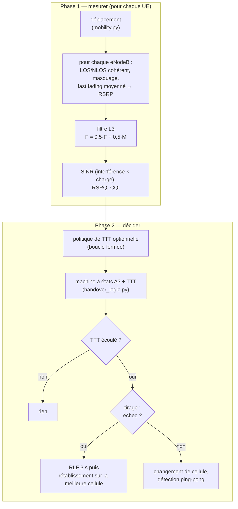

# Chapitre 5 — Le simulateur du projet

> **Objectif :** relier chaque concept des chapitres 1 à 4 au code, savoir ce qui est fidèle à la réalité et ce qui est simplifié, et pouvoir défendre les corrections de la version 4.

---

## 5.1 Ce qui est simulé

| Élément | Valeur | Commentaire |
|---|---|---|
| Zone | 1 km × 1 km | ville dense (*Urban Macro*) |
| eNodeB | 4, aux positions (250, 250), (750, 250), (250, 750), (750, 750) m | distance inter-sites 500 m, typique d'une macro-cellule urbaine |
| Émission | 46 dBm (40 W) à 2 GHz, 10 MHz (50 RB) | soit **18,2 dBm par RE** pour le RSRP |
| UE | 8 piétons (0,5–2 m/s) + 7 véhicules (8–20 m/s) | nouvelle vitesse tirée à chaque trajet (*waypoint*) |
| Mobilité | *Random Waypoint* avec persistance de direction | piétons : trajets courts (≤ 200 m), pauses ≤ 10 s ; véhicules : toute la grille |
| Pas de temps | 1 s | une mesure, une décision de handover par seconde |
| Durée | 3 600 s | 54 000 lignes |

## 5.2 Une seconde de simulation, étape par étape

Le cœur est la classe `Simulator` (`src/simulator.py`). Chaque seconde se déroule en deux phases :

**Deux générateurs aléatoires indépendants** sont utilisés : l'un pour la mobilité et le canal radio, l'autre pour les tirages d'échec de handover. Ainsi, deux simulations avec la même graine voient **exactement les mêmes trajectoires et le même canal**, même si une politique change les décisions de handover. C'est ce qui rend la comparaison du chapitre 9 rigoureuse (un test le vérifie).

## 5.3 Du concept au code

| Concept (chapitre) | Fonction / paramètre | Valeur |
|---|---|---|
| Path loss UMa LOS / NLOS (2) | `path_loss_los`, `path_loss_nlos` | TR 36.873 |
| Probabilité LOS (2) | `p_los` | $\min(18/d,1)(1-e^{-d/63}) + e^{-d/63}$ |
| LOS cohérent dans l'espace (2) | `update_los_latent`, `los_from_latent` | décorrélation 50 m (TR 38.901) |
| Masquage (2) | `update_shadow` | σ 4 / 6 dB, décorrélation 100 m |
| Fast fading moyenné (2) | `update_fast_fading` | 1 échantillon par λ/2 parcouru |
| RSRP par RE (3) | `compute_rsrp`, `RadioConfig.rs_power_dbm` | 46 − 27,8 = 18,2 dBm |
| Plage de rapport (3) | `report_rsrp` | [−140, −44] dBm |
| SINR (2, 3) | `compute_sinr` | interférence × (0,1 + 0,9·charge), bruit −95,5 dBm |
| RSRQ, CQI (3) | `compute_rsrq`, `sinr_to_cqi` | table TS 36.213 |
| Filtre L3 (4) | `l3_update`, `HOConfig.l3_alpha` | a = 0,5 (k = 4) |
| A3 + marge (4) | `evaluate_handover`, `ho_margin_db` | 3 dB |
| TTT selon la vitesse (4) | `velocity_ttt` | max(1, 3 − ⌊v/7⌋) s |
| Échec du handover (4) | `ho_failure_prob` | SINR 50 %, vitesse 15 %, cible 15 %, durée en faible RSRP 20 % ; plafond 75 % |
| RLF et rétablissement (4) | `Simulator._decide` | 3 s exactement, puis meilleure cellule |
| Ping-pong (4) | `is_ping_pong`, `pp_extra_margin_db` | retour en < 10 s ; +3 dB pendant 20 s |
| Label (6) | `add_handover_soon_label` | handover réussi dans les 3 s |

## 5.4 Les corrections de la version 4

La revue du projet a relevé des écarts à la réalité. Les savoir expliquer montre qu'on maîtrise à la fois la télécom et l'esprit critique sur ses propres données.

| # | Problème en v3 | Pourquoi c'est faux | Correction v4 | Effet mesuré |
|---|---|---|---|---|
| 1 | RSRP calculé avec les 46 dBm totaux | le RSRP est la puissance **d'un RE** | puissance par RE (−27,8 dB), seuils décalés d'autant, plage −44 dBm | 0 valeur au-dessus de −44 dBm (20 % avant) ; SINR inchangé |
| 2 | LOS retiré toutes les 5 s, indépendamment du mouvement | un piéton immobile ne passe pas de LOS à NLOS | processus latent corrélé à la distance (TR 38.901) | handovers piétons : **114 → ~38 par heure** ; ping-pong piétons 27 % → ~10 % |
| 3 | fast fading = un échantillon Rayleigh par seconde | un terminal **moyenne** ses mesures | moyenne de puissance sur 1 + Δd/(λ/2) échantillons | variations rapides ±5 dB → ~1 dB (piéton) |
| 4 | vitesse constante par UE, non nulle à l'arrêt | la vitesse servait d'identifiant d'UE | nouvelle vitesse par trajet, 0 à l'arrêt | la variable a un sens physique |
| 5 | RLF de 2 s au lieu de 3, UE laissé sur la cellule défaillante | erreur d'ordre des opérations | décrément après la décision ; rétablissement RRC | conforme à la configuration |
| 6 | tentatives échouées comptées dans l'historique ping-pong | un échec n'est pas un handover | seuls les handovers exécutés y entrent | détection correcte |
| 7 | bruit à −107 dBm | kTB sur 9 MHz = −104,5 dBm, + facteur de bruit | −95,5 dBm | négligeable (réseau limité par l'interférence) |

> 🎯 **Comment le présenter :** « En relisant mon simulateur avec un œil de radio, j'ai trouvé qu'il calculait le RSRP avec la puissance totale au lieu de la puissance par RE, et que l'état LOS changeait même pour un terminal immobile, ce qui créait des handovers artificiels. J'ai corrigé, mesuré l'effet, et j'ai tout ré-entraîné. »

## 5.5 Le dataset obtenu

| Statistique (seed 42, 1 h, 15 UE) | Valeur |
|---|---|
| Lignes | 54 000 |
| Secondes positives (`handover_soon = 1`) | **6,4 %** |
| Tentatives de handover | 1 434 (≈ 96 par UE et par heure) |
| — réussies | 1 199 (83,6 %) |
| — échouées → RLF | 235 (16,4 %) |
| Ping-pong (parmi les réussies) | 244 (20,4 %) |
| Étiquette d'événement | A3 57,7 % · A4 24,8 % · A5 17,5 % |
| Piétons / véhicules | 38 / 161 tentatives par UE et par heure |
| Rétablissements RRC après RLF | 209 |
| Liens de service en LOS | 24,4 % du temps |
| RSRP de service | de −131,5 à −44 dBm (0,8 % des valeurs au plafond de −44) |
| SINR médian | 16,5 dB |

**Lecture.** Les véhicules changent de cellule environ 4 fois plus souvent que les piétons, ce qui est logique : ils traversent les frontières plus vite. Le taux d'échec (~16 %) et le taux de ping-pong (~20 %) sont élevés pour un réseau réel optimisé. Ils reflètent un réseau **non optimisé** (marge et TTT fixes, aucun MRO), ce qui laisse justement de la place à une amélioration par la prédiction (chapitre 9).

## 5.6 Les limites à connaître (et à assumer)

Un simulateur reste un modèle. Il faut savoir dire ce qu'il ne fait pas :

- **Données synthétiques.** La vraie validation serait des traces réelles (drive tests, données OSS d'un opérateur).
- **Pas de temps d'une seconde.** Les vrais terminaux mesurent toutes les ~200 ms et le TTT descend à 40 ms ; le simulateur est plus grossier.
- **Transitions LOS franches.** Même avec la cohérence spatiale, passer de LOS à NLOS est un saut d'environ 20 dB. C'est la principale source restante de handovers piétons (~38 par heure, plus que dans un vrai réseau). Un essai de transition « douce » (*soft LOS*) a augmenté ce nombre au lieu de le réduire ; il n'a pas été retenu.
- **Réseau minuscule.** 4 cellules sans *wrap-around* : les UE près des bords voient moins d'interférence qu'au centre d'un vrai réseau.
- **Simplifications** : pas d'antennes sectorisées ni de diagramme d'antenne, RSRQ approché, une seule fréquence, A4/A5 utilisés comme étiquettes et non comme déclencheurs, modèle d'échec heuristique (calibré pour ~15–20 % d'échecs, valeur pessimiste par rapport à un réseau optimisé).

⬅️ [Chapitre 4](04_mobilite_et_handover.md) · ➡️ [Chapitre 6 — le problème de ML](06_probleme_ml_et_donnees.md)
