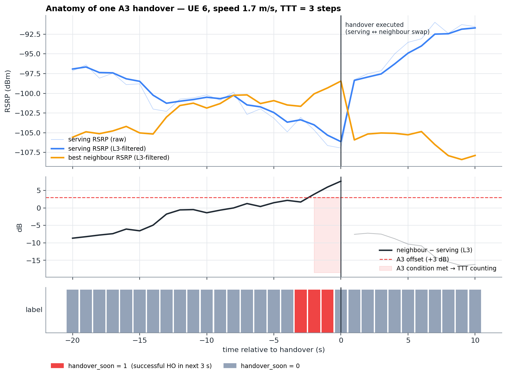
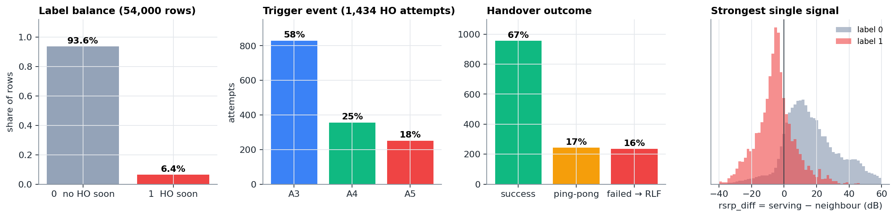
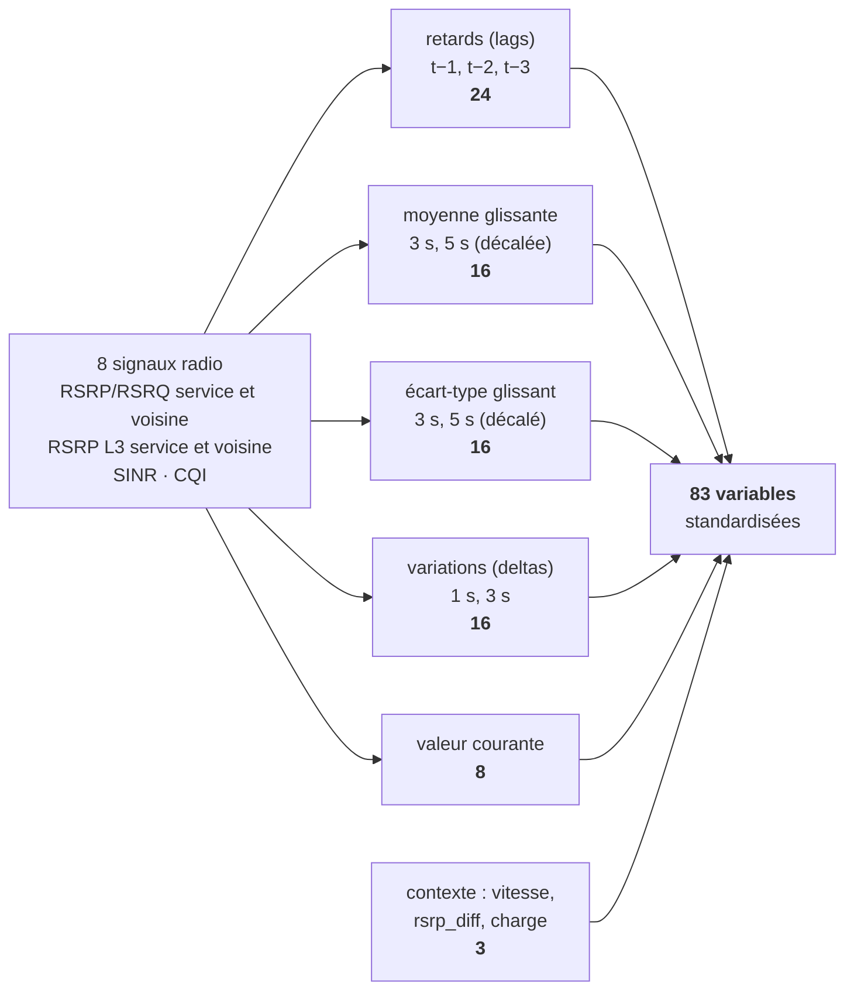
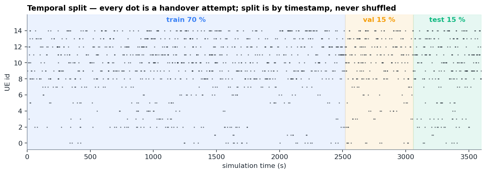

# Chapitre 6 — Le problème de ML : label, données, variables

> **Objectif :** savoir formuler précisément ce que le modèle prédit et pourquoi, expliquer chaque variable d'entrée, et démontrer que le pipeline **ne triche pas** (pas de fuite de données).

---

## 6.1 La question posée au modèle

À chaque seconde $t$, pour chaque UE, le modèle répond à :

> **« Un handover *réussi* va-t-il avoir lieu pour cet UE dans les 3 prochaines secondes ? »**

C'est une **classification binaire** : la sortie est une probabilité $p \in [0, 1]$, transformée en décision (alarme / pas d'alarme) par un **seuil**.

Le label s'appelle `handover_soon` :

$$\text{handover\_soon}(t) = 1 \iff \exists\, k \in \{1, 2, 3\} : \text{un handover réussi a lieu à } t+k$$

Il est calculé dans `src/simulator.py` (`add_handover_soon_label`).

La figure montre un vrai handover du dataset : le label (bandeau du bas) passe à 1 **trois secondes avant** le handover, souvent avant même que la condition A3 soit remplie. Le modèle doit donc reconnaître une **trajectoire** qui mène au handover, pas seulement l'état « A3 vrai ».

### Pourquoi 3 secondes ?

| Horizon | Avantage | Inconvénient |
|---|---|---|
| 1 s | facile à prédire | trop tard pour préparer quoi que ce soit |
| **3 s** | **laisse le temps de préparer la cible (échanges X2 ~ dizaines de ms) ou d'avancer le handover** | **le label reste lié à des tendances radio observables** |
| 10 s | très utile opérationnellement | la mobilité est imprévisible à cette échelle : bruit énorme dans le label |

### Pourquoi seulement les handovers *réussis* ?

Les tentatives qui échouent mènent à une RLF, qui est un autre phénomène (le lien casse). Les mélanger au label brouillerait la cible. Le modèle apprend à anticiper les **handovers qui ont vraiment lieu**.

### Un problème déséquilibré

Seuls **~6 % des secondes** sont positives : un UE passe la plupart de son temps loin d'un handover. Conséquences, détaillées aux chapitres 7 et 8 :

- l'**accuracy** est trompeuse (un modèle qui dit toujours « non » a 94 % d'accuracy) ;
- il faut **rééquilibrer l'apprentissage** (pondération des classes) ;
- il faut des métriques adaptées (**F1, PR-AUC**) et **choisir le seuil**.

## 6.2 Les données

| Élément | Valeur |
|---|---|
| Réseau | 4 eNodeB sur une grille de 1 km², distance inter-sites 500 m |
| UE | 15 : 8 piétons (0,5–2 m/s) et 7 véhicules (8–20 m/s) |
| Durée | 3 600 s (1 h), pas de 1 s |
| Lignes | 54 000 (15 UE × 3 600 s) |
| Colonnes brutes | 27 (mesures, contexte, événements, label) |
| Graine aléatoire | 42 (dataset reproductible à l'identique) |

> 💡 **Pourquoi simuler ?** Il n'existe pas de dataset public de mesures LTE **étiquetées** par les handovers, au pas de la seconde, avec les voisines. Les traces réelles des opérateurs sont confidentielles. Le simulateur permet aussi des **expériences impossibles sur un vrai réseau** : rejouer exactement la même heure avec une autre politique de handover (chapitre 9).

## 6.3 Les variables d'entrée (83 features)

### Pourquoi ces transformations ?

Un modèle « tabulaire » (régression logistique, forêt, XGBoost) ne voit qu'**une ligne à la fois** : il ne sait pas ce qui s'est passé avant. On lui **donne la mémoire** sous forme de colonnes.

| Famille | Exemple | Ce que ça capture |
|---|---|---|
| **Lag** (retard) | `rsrp_serving_lag3` = RSRP il y a 3 s | l'état passé |
| **Delta** (variation) | `rsrp_serving_delta3` = RSRP(t) − RSRP(t−3) | la **tendance** : « le signal chute de 6 dB en 3 s » |
| **Moyenne glissante** | `sinr_roll5_mean` | le niveau de fond, débarrassé du bruit |
| **Écart-type glissant** | `rsrq_serving_roll5_std` | l'**instabilité** : un lien qui fluctue est souvent en bord de cellule |

> 🎯 La tendance **complète** le niveau : un RSRP de −100 dBm stable n'annonce rien, alors qu'un RSRP qui passe de −90 à −100 dBm en 3 s pendant que la voisine monte annonce un handover. L'analyse SHAP (chapitre 8) montre que l'état courant (écart service/voisine, SINR, RSRQ) et la vitesse portent l'essentiel de la décision, et que les variables temporelles en apportent environ un tiers.

## 6.4 Pas de fuite de données : comment on le garantit

Une **fuite de données** (*data leakage*), c'est quand le modèle voit pendant l'entraînement une information qu'il n'aura pas en production. Ses scores sont alors faussement bons. Le projet en évite cinq formes.

**1. Pas d'information du futur dans les variables.** Les lags et les deltas ne regardent que le passé. Les fenêtres glissantes sont **décalées d'un pas** (`shift(1)`) : la moyenne sur 5 s à l'instant $t$ utilise $t-5 \dots t-1$. Un test automatique (`tests/test_features.py`) réécrit le futur d'un UE et vérifie que les variables du passé ne bougent pas.

**2. Un découpage temporel, jamais aléatoire.** Les 70 % premières secondes servent à l'entraînement, les 15 % suivantes à la validation, les 15 % dernières au test. Un découpage aléatoire mettrait la seconde $t$ en entraînement et la seconde $t+1$ (presque identique) en test, ce qui gonfle les scores.

**3. Normalisation apprise sur l'entraînement seulement.** Le `StandardScaler` (centrer-réduire chaque variable) calcule moyennes et écarts-types **sur le train uniquement**, puis les applique à la validation et au test.

**4. Pas de variables qu'un réseau n'observe pas.** La position (`pos_x`, `pos_y`) et l'état LOS (`los_flag`) existent dans le dataset (pour l'analyse et les figures) mais **ne sont pas des entrées du modèle** depuis la v4.

**5. Sélection du modèle sans regarder le test.** Seuils et choix du champion se font sur la **validation** ; le test n'est lu qu'à la fin (chapitre 8).

## 6.5 Du hors-ligne au temps réel

En production, les mesures arrivent seconde par seconde. Deux implémentations calculent **exactement les mêmes variables** :

- `build_features()` (hors ligne) : pour l'entraînement, `predict.py` et le dashboard. Elle accepte des lignes dans n'importe quel ordre, les regroupe par UE, les trie par temps, et **conserve l'index d'origine** pour rattacher chaque score à sa ligne ;
- `OnlineFeatureBuffer` (en ligne) : garde les 5 dernières mesures de chaque UE et calcule les variables de la nouvelle seconde. C'est lui qui tourne dans la boucle fermée (chapitre 9).

Un test vérifie que les deux donnent les mêmes valeurs (écart < 10⁻⁸). Les **3 premières secondes** de chaque UE n'ont pas d'historique : elles sont marquées *warm-up* et ne sont pas notées, plutôt que d'être remplies avec des zéros.

> 🐛 **Anecdote utile en entretien :** la v3 avait deux bugs à cet endroit. `predict.py` ne calculait pas les variables temporelles et rejetait donc **100 % des lignes** d'un fichier de mesures brutes. Le dashboard recalculait les variables en réordonnant les lignes par UE, puis rattachait les scores **par position** : pour un fichier trié par temps, chaque risque était affiché sur la mauvaise ligne. La correction : un seul chemin d'inférence (`src/serving.py`), rattachement **par index**, et un test qui mélange l'ordre des lignes et vérifie que les scores ne changent pas.

## 6.6 Ce qu'il faut retenir

- Cible : **handover réussi dans les 3 s**, classification binaire **déséquilibrée** (~6 %).
- **83 variables** : 8 signaux × (valeur, 3 lags, 2 moyennes, 2 écarts-types, 2 deltas) + vitesse, `rsrp_diff`, charge.
- Les variables temporelles donnent la **mémoire** et la **tendance** aux modèles tabulaires.
- **Anti-fuite** : fenêtres décalées, split temporel, scaler sur le train, pas de position ni de LOS, sélection sur la validation.

⬅️ [Chapitre 5](05_simulateur.md) · ➡️ [Chapitre 7 — les modèles](07_modeles.md)
