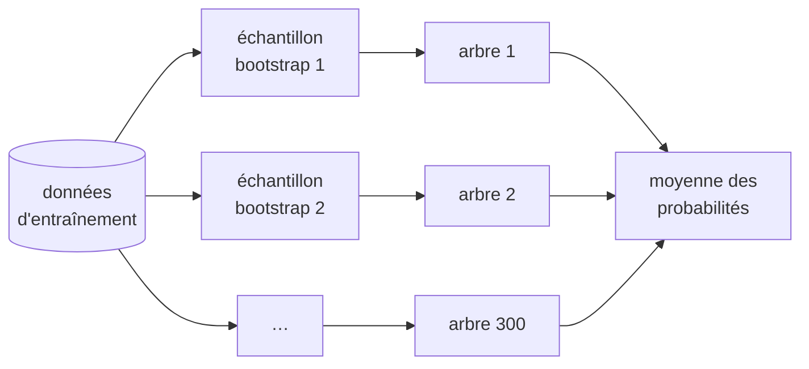
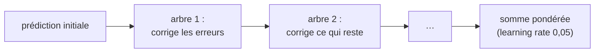
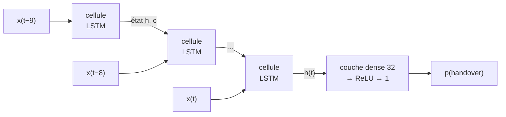
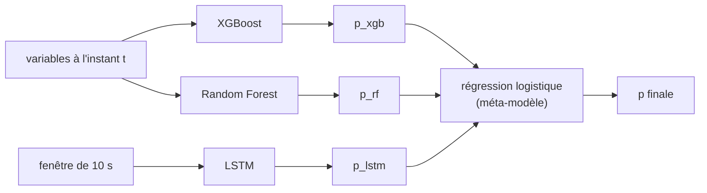

# Chapitre 7 — Les modèles

> **Objectif :** comprendre comment fonctionne chacun des sept modèles comparés, quels hyperparamètres ont été choisis et pourquoi, et comment le déséquilibre des classes est traité.

---

## 7.1 Vue d'ensemble

| Famille | Modèle | Idée en une phrase | Voit l'historique comment ? |
|---|---|---|---|
| Baseline | **Règle A3** | probabilité = sigmoïde de l'écart L3 voisine − service | pas du tout (valeur instantanée) |
| Linéaire | **Régression logistique** | somme pondérée des variables → sigmoïde | via les lags/deltas |
| Arbres (bagging) | **Random Forest** | vote de 300 arbres entraînés sur des échantillons différents | via les lags/deltas |
| Arbres (boosting) | **XGBoost** | arbres ajoutés un à un pour corriger les erreurs des précédents | via les lags/deltas |
| Réseaux récurrents | **LSTM**, **GRU** | lisent une fenêtre de 10 s pas à pas, avec une mémoire interne | directement (séquence) |
| Ensemble | **Stacking** | une régression logistique combine XGBoost, RF et LSTM | via les modèles de base |

> 💡 **Pourquoi plusieurs familles ?** Pour répondre à la question « quel gain apporte la complexité ? ». La règle mesure ce que donne la logique A3 seule ; la régression logistique, un modèle linéaire ; les arbres, les interactions non linéaires ; les LSTM, l'apprentissage direct de la dynamique. Si un modèle simple suffisait, il faudrait le préférer.

## 7.2 La baseline : une règle sans apprentissage

$$p = \frac{1}{1 + e^{-(\Delta_{L3} - 3)/2}} \qquad \Delta_{L3} = RSRP^{L3}_{voisine} - RSRP^{L3}_{service}$$

La probabilité vaut 0,5 quand la voisine dépasse la cellule de service de 3 dB (la marge A3), et monte quand l'écart grandit. C'est **ce que ferait un ingénieur sans ML**. Tout modèle appris doit faire mieux, sinon il ne sert à rien (`RuleA3Gap` dans `src/models.py`).

## 7.3 La régression logistique

Le modèle calcule un score linéaire, puis le passe dans une sigmoïde :

$$p = \sigma(w^\top x + b) = \frac{1}{1 + e^{-(w^\top x + b)}}$$

Les poids $w$ minimisent la **perte logistique** (*log-loss*, entropie croisée), avec une **régularisation** L2 qui empêche les poids d'exploser ($C = 0{,}5$ : plus $C$ est petit, plus la régularisation est forte).

- ✅ rapide, interprétable (un poids par variable), bien calibré ;
- ❌ ne capte que des relations **linéaires** : il ne peut pas exprimer « si le RSRP baisse **et** que la voisine monte **et** que l'UE est rapide ».

## 7.4 Les arbres de décision, la forêt aléatoire et XGBoost

### Un arbre de décision

Un arbre pose une suite de questions binaires (« `rsrp_diff` < −2 dB ? », « `sinr_delta3` < −4 dB ? ») et prédit en fonction de la feuille atteinte. Chaque question est choisie pour séparer au mieux les classes (critère de Gini ou d'entropie). Un arbre seul **sur-apprend** facilement : il finit par mémoriser le bruit.

### Random Forest (bagging)

On entraîne **300 arbres**, chacun sur un tirage aléatoire des données (*bootstrap*) et en ne regardant qu'un sous-ensemble aléatoire de variables à chaque division. Leurs erreurs sont en partie indépendantes, donc **la moyenne réduit la variance**.

Hyperparamètres : `n_estimators=300`, `max_depth=12` (limite la complexité), `min_samples_leaf=5` (pas de feuille sur moins de 5 exemples).

### XGBoost (boosting de gradient)

Ici les arbres sont **séquentiels** : chacun est ajusté sur le **gradient de la perte** des précédents, c'est-à-dire sur ce qu'ils ont encore mal prédit. Le *learning rate* (0,05) rend chaque correction petite, ce qui demande plus d'arbres mais généralise mieux.

Hyperparamètres : profondeur 6, `subsample=0.8` et `colsample_bytree=0.8` (chaque arbre voit 80 % des lignes et des colonnes), jusqu'à 1 500 arbres, et **arrêt anticipé** : on s'arrête quand la **PR-AUC de validation** ne progresse plus pendant 30 arbres. L'entraînement s'arrête vers ~120 arbres.

> 🔧 **Choix de la métrique d'arrêt :** avec la *log-loss* comme critère, XGBoost allait jusqu'à ~900 arbres et sa PR-AUC de validation **baissait** (0,41 contre 0,46). La log-loss récompense la calibration globale, dominée par les 94 % de négatifs ; la PR-AUC mesure ce qui nous intéresse : bien classer les rares positifs.

## 7.5 Les réseaux récurrents : LSTM et GRU

Au lieu de recevoir l'historique sous forme de colonnes, un réseau récurrent **lit la séquence** des 10 dernières secondes (10 vecteurs de 83 variables), un pas après l'autre, en mettant à jour un **état caché** qui résume ce qu'il a vu.

La cellule **LSTM** (*Long Short-Term Memory*) a trois **portes** apprises (oubli, entrée, sortie) qui décident quoi garder, quoi ajouter et quoi exposer de sa mémoire. Cela évite l'évanouissement du gradient des RNN simples. La **GRU** (*Gated Recurrent Unit*) est une version simplifiée à deux portes, avec moins de paramètres.

Architecture du projet : 2 couches de 64 unités, *dropout* 0,3, puis une couche dense de 32 neurones. Entraînement : Adam (lr = 10⁻³), mini-lots de 256, réduction du lr sur plateau, **arrêt anticipé sur la PR-AUC de validation** (patience 5).

**Les fenêtres sont construites UE par UE :** une fenêtre ne mélange jamais deux terminaux. Les 9 premières secondes d'un UE sont complétées avec sa propre première mesure (`score_sequence_model`). En v3, l'inférence glissait la fenêtre sur tout le fichier : les 9 premières lignes de chaque UE utilisaient l'historique du terminal précédent.

> 💡 **Pourquoi les LSTM ne battent-ils pas les arbres ici ?** Parce que les variables de lag, delta et fenêtre glissante **donnent déjà la dynamique** aux modèles tabulaires. La fenêtre de 10 s n'apporte pas beaucoup plus d'information que ces résumés. Les LSTM brillent quand la dynamique utile est longue ou complexe, ou quand on ne sait pas quelles variables construire.

## 7.6 Le stacking

Le méta-modèle apprend **comment pondérer** les trois avis. Il est entraîné sur les prédictions de la **validation** (les modèles de base ne l'ont pas vue pour apprendre). Deux précautions :

- `class_weight="balanced"` sur le méta-modèle (sinon, avec 6 % de positifs, son seuil 0,5 est beaucoup trop haut : en v3 il ne détectait que 40 % des handovers) ;
- pour **comparer équitablement** le stacking aux autres modèles sur la validation, son score de validation est calculé **hors échantillon** (*out-of-fold*, validation croisée en 5 blocs temporels). Sinon il serait évalué sur les données mêmes qui ont servi à l'entraîner.

## 7.7 Traiter le déséquilibre des classes

Avec 6 % de positifs, un modèle naïf apprend à toujours répondre « non ». Chaque famille a son mécanisme :

| Modèle | Mécanisme | Effet |
|---|---|---|
| Régression logistique, RF | `class_weight = {1: n_neg/n_pos}` | chaque positif compte ~15 fois plus dans la perte / le critère de division |
| XGBoost | `scale_pos_weight = n_neg/n_pos` | multiplie le gradient des positifs |
| LSTM, GRU | `WeightedRandomSampler` | les mini-lots contiennent ~50 % de positifs |
| Stacking | `class_weight="balanced"` | idem pour le méta-modèle |

> 🐛 **Bug corrigé, à raconter :** en v3, les LSTM/GRU combinaient le *sampler* équilibré **et** un `pos_weight` dans la perte. Les positifs étaient donc pondérés deux fois, soit (n_neg/n_pos)² ≈ 240× au taux actuel de 6 %. Le réseau poussait toutes ses probabilités vers le haut : précision ≈ 0,33. Une seule correction suffit ; la v4 garde le *sampler* seul.

**Le rééquilibrage déplace les probabilités** : un modèle pondéré sur-estime la probabilité des positifs. Ses sorties ne sont plus des « vraies » probabilités, d'où l'importance de **choisir le seuil sur la validation** (chapitre 8) plutôt que de garder 0,5.

## 7.8 Reproductibilité

Toutes les sources d'aléa sont fixées : graine du simulateur (42), `random_state=42` pour scikit-learn et XGBoost, `torch.manual_seed`, générateur du *sampler*, algorithmes déterministes. **Deux exécutions complètes du pipeline (`dvc repro`) donnent des métriques identiques à la 4ᵉ décimale pour les sept modèles**, LSTM et GRU compris. En v3, ces derniers variaient d'environ ±0,015 de F1 d'une exécution à l'autre.

## 7.9 Ce qu'il faut retenir

- Sept modèles de complexité croissante, dont une **règle sans apprentissage** comme référence.
- **Bagging** (RF) réduit la variance ; **boosting** (XGBoost) réduit le biais pas à pas ; **LSTM/GRU** lisent la séquence brute ; le **stacking** combine.
- Déséquilibre : **une** pondération par modèle (pas deux !), puis seuil choisi sur la validation.
- Arrêt anticipé sur la **PR-AUC**, adaptée aux classes rares.

⬅️ [Chapitre 6](06_probleme_ml_et_donnees.md) · ➡️ [Chapitre 8 — évaluation et résultats](08_evaluation_et_resultats.md)
