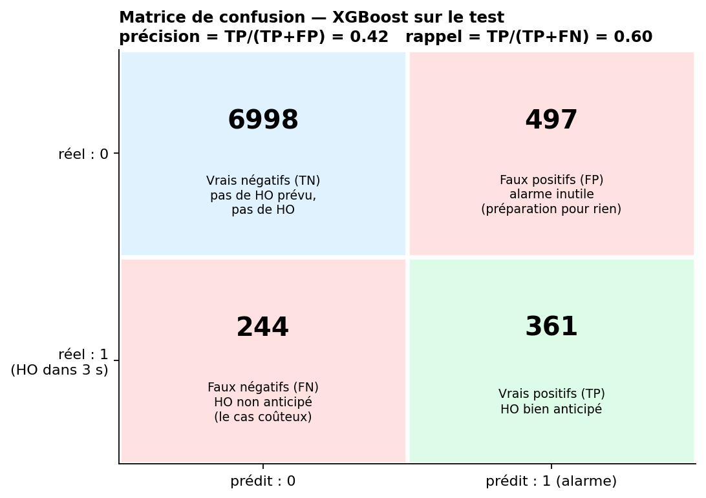
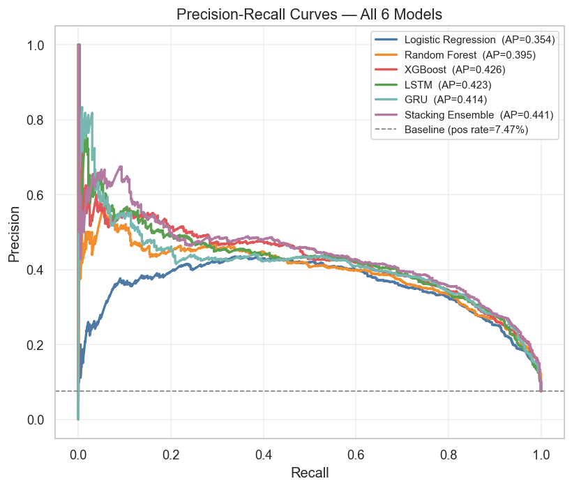
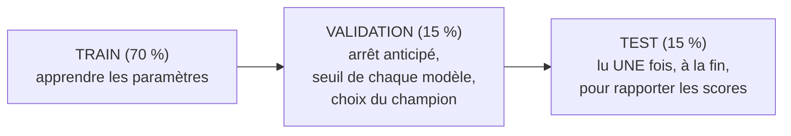
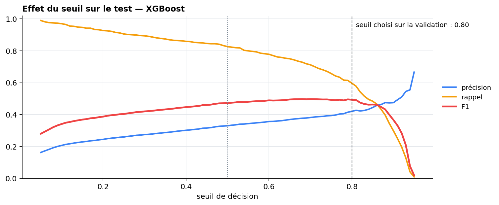
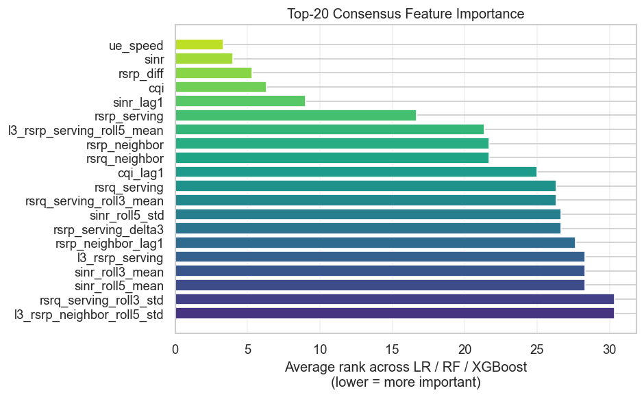

# Chapitre 8 — Évaluation et résultats

> **Objectif :** savoir lire et défendre chaque métrique, expliquer comment le seuil et le champion sont choisis sans tricher, et présenter les résultats, y compris ce que le modèle **ne** sait **pas** faire.

---

## 8.1 La matrice de confusion

Avec un seuil, chaque prédiction tombe dans l'une de quatre cases :

| Métrique | Formule | Question à laquelle elle répond |
|---|---|---|
| **Précision** | TP / (TP + FP) | « Quand j'alarme, ai-je raison ? » (coût : préparations inutiles) |
| **Rappel** | TP / (TP + FN) | « Parmi les handovers à venir, combien ai-je vus ? » (coût : handovers non anticipés) |
| **F1** | 2·P·R / (P + R) | moyenne harmonique : élevée seulement si **les deux** le sont |
| Accuracy | (TP + TN) / total | **trompeuse ici** : « toujours non » donne 92 % |

## 8.2 ROC-AUC et PR-AUC

Ces deux métriques **ne dépendent pas du seuil** : elles mesurent la qualité du **classement** (les positifs ont-ils des scores plus élevés que les négatifs ?).

- **ROC-AUC** : aire sous la courbe taux de vrais positifs / taux de faux positifs. 0,5 = hasard, 1 = parfait. Interprétation : probabilité qu'un positif tiré au hasard ait un score supérieur à un négatif tiré au hasard.
- **PR-AUC** (*average precision*) : aire sous la courbe précision / rappel. Le hasard vaut le **taux de positifs** (7,5 % sur le test), et non 0,5.

La même analyse dans le notebook 10, où la ligne pointillée marque le niveau du hasard (taux de positifs = 7,5 %) :

> 🎯 **Pourquoi regarder la PR-AUC quand les positifs sont rares ?** Le taux de faux positifs (axe de la ROC) a pour dénominateur les **négatifs**, très nombreux : 500 fausses alarmes sur 7 400 négatifs ne font que 7 %, et la courbe ROC reste flatteuse. La précision a pour dénominateur les **alarmes** : les mêmes 500 fausses alarmes pour 300 vraies donnent une précision de 37 %. La PR-AUC montre donc ce que vivra l'opérateur. C'est pour cela que les modèles plafonnent vers 0,92 de ROC-AUC mais 0,43 de PR-AUC.

## 8.3 Choisir le seuil, choisir le modèle, sans regarder le test

Le protocole est en trois temps, sur trois jeux de données disjoints dans le temps :

**Le seuil.** Les modèles pondérés (chapitre 7) ne sont pas calibrés : 0,5 n'a pas de sens particulier. Pour chaque modèle, on balaie les seuils de 0,05 à 0,95 sur la **validation** et on garde celui qui maximise le F1. Pour XGBoost, c'est **0,80**.

**Le champion** maximise $0{,}6 \times F1_{val} + 0{,}4 \times AUC_{val}$ (chapitre 10).

**Tous les modèles sont évalués sur les mêmes lignes** : les lignes de test qui ont 10 s d'historique, nécessaires aux LSTM. En v3, les modèles tabulaires étaient évalués sur plus de lignes que les LSTM, ce qui faussait légèrement la comparaison.

## 8.4 Les résultats

**Validation** (sert à choisir) :

| Modèle | Seuil | F1 | ROC-AUC | PR-AUC | Score de sélection |
|---|---|---|---|---|---|
| **XGBoost** ★ | 0,80 | **0,502** | **0,927** | **0,471** | **0,672** |
| Random Forest | 0,60 | 0,500 | 0,923 | 0,434 | 0,669 |
| Stacking | 0,89 | 0,502 | 0,920 | 0,432 | 0,669 |
| GRU | 0,81 | 0,479 | 0,915 | 0,411 | 0,653 |
| LSTM | 0,82 | 0,470 | 0,905 | 0,388 | 0,644 |
| Régression logistique | 0,78 | 0,457 | 0,909 | 0,322 | 0,637 |
| Règle A3 (non éligible) | 0,16 | 0,409 | 0,856 | 0,236 | — |

**Test** (rapporté une seule fois ; 7 965 lignes, 7,5 % de positifs) :

| Modèle | Précision | Rappel | F1 | ROC-AUC | PR-AUC |
|---|---|---|---|---|---|
| **XGBoost** ★ | 0,424 | 0,601 | **0,497** | 0,921 | 0,431 |
| LSTM | 0,413 | 0,627 | 0,498 | 0,916 | 0,423 |
| GRU | 0,405 | 0,628 | 0,492 | 0,916 | 0,414 |
| Stacking | 0,435 | 0,563 | 0,491 | **0,923** | **0,441** |
| Random Forest | 0,403 | 0,623 | 0,489 | 0,916 | 0,401 |
| Régression logistique | 0,392 | 0,627 | 0,482 | 0,909 | 0,356 |
| **Règle A3** | 0,296 | 0,603 | **0,397** | **0,853** | **0,262** |

### Comment les présenter

1. **Le ML apporte un gain net sur la règle** : +0,10 de F1, +0,07 de ROC-AUC, PR-AUC multipliée par ~1,6. À rappel égal (~60 %), la règle donne 30 % de précision contre 42 % pour XGBoost : beaucoup moins d'alarmes inutiles.
2. **Les modèles appris sont très proches entre eux** (F1 0,48–0,50 sur le test). Les écarts sont de l'ordre du bruit statistique. Le choix du champion se joue à 0,003 près sur la validation : en entretien, ne surinterprétez pas le classement.
3. **Un F1 de 0,5 est un résultat honnête, pas un échec.** Le label demande de prédire un événement **3 s à l'avance**, dans un canal partiellement aléatoire (masquage, transitions LOS). Une partie des handovers n'a simplement **pas de signe avant-coureur** 3 s avant. Un AUC de 0,92 montre que le classement est bon ; le plafond du F1 vient du déséquilibre et du bruit du label.

## 8.5 L'évaluation opérationnelle : penser en événements

Un opérateur ne raisonne pas en secondes bien classées, mais en **handovers anticipés** et en **coût des alarmes**. Trois métriques (`src/operational.py`) :

- **rappel événementiel à 3 s** : part des handovers réussis précédés d'au moins une alarme dans les 3 s ;
- **délai d'anticipation** : quand arrive la première alarme ;
- **temps de fausse alarme** : part des secondes où une alarme n'est suivie d'aucun handover dans les 3 s, c'est-à-dire le temps passé à préparer un handover pour rien.

> 🐛 **Piège évité :** une première version comptait les fausses alarmes par *épisode* (suite de secondes d'alarme consécutives). Un modèle qui alarme **en permanence** ne produit alors qu'un seul épisode, donc « presque aucune fausse alarme » ! Le stacking obtenait ainsi un rappel de 100 % sous un budget de fausses alarmes très bas. Mesurer le coût **en temps** corrige ce biais (un test le vérifie).

Comparer les modèles à leur seuil respectif mélange deux choses. On trace donc des **courbes opérationnelles** (rappel événementiel en fonction du temps de fausse alarme, seuil balayé) et on compare **à budget égal** :

| Modèle | Handovers anticipés à ≤ 5 % de temps de fausse alarme |
|---|---|
| Stacking | **85 %** |
| **XGBoost** ★ | **83 %** |
| GRU | 81 % |
| Random Forest | 79 % |
| Régression logistique | 78 % |
| LSTM | 75 % |
| **Règle A3** | **68 %** |

Au seuil choisi, XGBoost anticipe **89 % des handovers** (91 % dans les 5 s), avec une première alarme **3,4 s** avant en moyenne, pour 6,1 % de temps de fausse alarme.

> 🎯 **Phrase à retenir :** « Pour un même coût d'alarmes inutiles (5 % du temps), mon modèle anticipe 83 % des handovers contre 68 % pour la règle A3. »

## 8.6 Explicabilité : SHAP

**SHAP** (*SHapley Additive exPlanations*) décompose chaque prédiction en contributions additives des variables, selon la théorie des jeux (valeurs de Shapley) :

$$f(x) = \phi_0 + \sum_{j} \phi_j(x)$$

$\phi_0$ est la prédiction moyenne et $\phi_j$ la contribution de la variable $j$ pour cet exemple. Pour les arbres, `TreeExplainer` calcule ces valeurs exactement et rapidement.

**Importance globale pour le champion XGBoost** (moyenne de |φ| sur le test) :

| Rang | Variable | Part de l'attribution |
|---|---|---|
| 1 | `ue_speed` (vitesse) | 17,7 % |
| 2 | `rsrp_diff` (RSRP service − voisine) | 14,9 % |
| 3 | `sinr` | 9,8 % |
| 4 | `rsrq_serving` | 8,7 % |
| 5–7 | `rsrp_neighbor`, `rsrq_neighbor`, `rsrp_serving` | 3,2 / 3,1 / 2,1 % |
| 8+ | `sinr_lag1`, `rsrq_serving_roll3_mean`, `rsrp_neighbor_lag1`, `rsrp_neighbor_roll3_std`, `cqi`… | ≤ 1,8 % chacune |

Par famille : **valeurs courantes et contexte ≈ 63 %**, moyennes/écarts-types glissants ≈ 20 %, retards ≈ 10 %, variations ≈ 6 %.

**Comment l'interpréter :**

- **`rsrp_diff`** est l'écart qui pilote A3. Sa contribution est fortement **négative quand l'écart est positif** (service nettement meilleure → pas de handover ; corrélation valeur/SHAP de −0,84). Quand la voisine rattrape la cellule de service, la contribution devient positive. C'est la physique d'A3, retrouvée par le modèle.
- **SINR et RSRQ** baissent à l'approche de la frontière (chapitre 2) : ils indiquent la proximité du bord de cellule.
- **La vitesse arrive en tête**, et c'est logique : les véhicules changent de cellule ~4 fois plus souvent que les piétons, et leur TTT est plus court. La vitesse sert de **probabilité a priori** (« cet UE fait beaucoup de handovers »), que les variables radio affinent ensuite.
- **Les variables temporelles** pèsent ~37 % au total : aucune n'est dominante seule, mais ensemble elles apportent la **tendance** (la voisine monte-t-elle ? le lien est-il instable ?).

> ⚠️ **À dire honnêtement :** le modèle s'appuie d'abord sur l'**état courant** (écart service/voisine, SINR, RSRQ) et sur la vitesse ; la dynamique **complète** cette information plutôt qu'elle ne la remplace. C'est aussi pourquoi la règle A3, qui ne voit que l'écart instantané, fait déjà une partie du travail.

Le notebook 09 croise les importances des trois modèles explicables (rang moyen sur régression logistique, forêt et XGBoost) : vitesse, SINR, `rsrp_diff` et CQI arrivent en tête pour tous, ce qui montre que ce constat ne dépend pas du modèle.

Les graphiques de SHAP pour tous les modèles sont dans `reports/shap/` et dans l'onglet SHAP du dashboard ; le notebook 09 les analyse en détail.

## 8.7 Ce qu'il faut retenir

- Positifs rares → **F1 et PR-AUC**, pas l'accuracy. ROC-AUC élevée ≠ peu de fausses alarmes.
- **Seuil et champion choisis sur la validation**, test lu une fois.
- Champion **XGBoost** : test F1 0,50, ROC-AUC 0,92, PR-AUC 0,43, contre 0,40 / 0,85 / 0,26 pour la règle A3.
- En événements : **83 % des handovers anticipés** à 5 % de temps de fausse alarme (68 % pour la règle), ~3,4 s d'avance.
- SHAP : le modèle s'appuie d'abord sur l'**écart service/voisine, le SINR, le RSRQ et la vitesse** ; les tendances apportent ~37 % de l'attribution.

⬅️ [Chapitre 7](07_modeles.md) · ➡️ [Chapitre 9 — boucle fermée et généralisation](09_boucle_fermee_et_generalisation.md)
