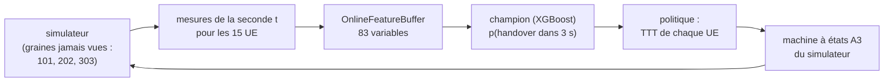

# Chapitre 9 — Boucle fermée et généralisation

> **Objectif :** répondre aux deux questions qu'un responsable technique posera forcément. **« Est-ce que votre prédiction améliore vraiment le réseau ? »** et **« Est-ce que ça marche sur un réseau que le modèle n'a jamais vu ? »**

---

## 9.1 De la prédiction à l'action

Un bon score de classification ne prouve pas qu'on améliore le réseau. La prédiction n'a de valeur que si on **agit** dessus. L'action la plus naturelle est d'adapter le **TTT** de chaque UE (chapitre 4) :

- si le modèle est **confiant qu'un handover arrive**, on raccourcit le TTT : le handover part plus tôt, quand le SINR est encore bon, donc il échoue moins ;
- si la condition A3 est vraie mais que le modèle pense que **ce n'est pas un vrai handover** (fluctuation passagère), on allonge le TTT pour éviter un ping-pong.

C'est une forme de **MRO prédictif**, UE par UE et seconde par seconde.

## 9.2 Le protocole expérimental

Cinq politiques sont comparées, sur **3 graines jamais vues × 1 800 s** :

| Politique | Règle | Rôle |
|---|---|---|
| `baseline` | TTT selon la vitesse (comme dans les données d'entraînement) | référence |
| `always_short` | TTT = 1 s pour tout le monde | réagir vite partout |
| `always_long` | TTT = 4 s pour tout le monde | filtrer partout |
| **`predictive`** | p ≥ 0,80 → TTT 1 s ; A3 vrai et p < 0,17 → TTT + 2 s ; sinon TTT normal | **la proposition** |
| `random_gate` | mêmes modifications, **mêmes taux**, mais à des instants tirés au hasard | **témoin** |

**Les deux seuils ne sont pas réglés sur ces graines.** Le seuil haut (0,80) est celui du champion choisi sur la validation ; le seuil bas (0,17) est le 5ᵉ centile des probabilités du champion sur les vrais positifs de la validation : seuls 5 % des vrais handovers seraient retenus.

**Pourquoi c'est rigoureux :**

- grâce aux **deux générateurs aléatoires** du simulateur, les 5 politiques voient **exactement les mêmes trajectoires et le même canal radio** pour une graine donnée : seules les décisions de handover diffèrent ;
- le **témoin aléatoire** applique les mêmes modifications avec la même fréquence (TTT raccourci sur ~9,5 % des UE-secondes, allongé sur 5 à 7 % des secondes où A3 est vrai). Si `predictive` fait mieux que `random_gate`, c'est que **le modèle choisit les bons moments**, pas seulement qu'on modifie le TTT plus souvent.

## 9.3 Les résultats

| Politique | Échecs de HO | Ping-pong | Secondes en RLF / UE·h | SINR à l'exécution | Temps avec SINR < −5 dB | Tentatives / UE·h |
|---|---|---|---|---|---|---|
| baseline | 14,9 % | 21,7 % | 62,1 | −6,2 dB | 3,9 % | 104 |
| random_gate | 14,2 % | 23,0 % | 60,6 | −5,9 dB | 3,7 % | 106 |
| **predictive** | **10,5 %** | 29,4 % | **55,5** | **−4,1 dB** | **2,6 %** | 132 |
| always_short | 11,0 % | 29,8 % | 59,6 | −4,0 dB | 2,5 % | 136 |
| always_long | 22,3 % | 7,5 % | 59,1 | −10,1 dB | 6,9 % | 66 |

*(moyennes sur 3 graines ; écarts-types dans `reports/closed_loop.json`)*

### Comment les lire

**1. La prédiction choisit les bons moments.** À fréquence de modification égale, le témoin aléatoire ne change presque rien par rapport à la référence (14,2 % d'échecs contre 14,9 %). La politique prédictive fait baisser les échecs de **14,9 % à 10,5 %** (−30 % relatifs), remonte le SINR au moment du handover de **2 dB**, et réduit d'un tiers le temps passé avec un SINR inférieur à −5 dB.

**2. Mais elle fait à peine mieux qu'une règle simple.** `always_short` obtient presque les mêmes gains (11,0 % d'échecs). La prédictive reste légèrement meilleure sur les quatre indicateurs (échecs, temps en RLF, ping-pong, nombre de tentatives), mais ces écarts sont de l'ordre d'un écart-type entre graines : **ils ne sont pas significatifs** avec 3 graines. Pourquoi si peu de différence ? Le modèle est surtout confiant **quand A3 est déjà vrai ou presque** : raccourcir le TTT « au bon moment » ressemble beaucoup à le raccourcir « toujours ».

**3. Le compromis de la mobilité apparaît clairement.** Avancer les handovers réduit les échecs mais **augmente les ping-pongs** (21,7 % → 29,4 %). `always_long` fait exactement l'inverse : 7,5 % de ping-pong, mais 22,3 % d'échecs et deux fois plus de temps en mauvais SINR. Aucune politique ne gagne sur les deux tableaux. C'est le dilemme « trop tardif contre ping-pong » du chapitre 4.

> 🎯 **Conclusion à donner en entretien :** « J'ai mis le modèle dans la boucle de décision du simulateur. À fréquence d'intervention égale, il réduit les échecs de handover de 30 % là où un témoin aléatoire ne fait rien : il détecte donc les bons moments. Mais une simple politique de TTT court fait presque aussi bien, et les deux augmentent les ping-pongs. Prédire **qu'un** handover arrive ne suffit pas : pour battre le compromis, il faudrait prédire **si ce handover va être un ping-pong**. C'est la suite logique du projet. »

Cette conclusion honnête vaut plus qu'un résultat flatteur : elle montre que vous savez concevoir un protocole qui peut **infirmer** votre hypothèse.

### Limite à mentionner

Le modèle a été entraîné sur des données produites avec la politique `baseline`. Quand la politique change l'instant des handovers, la distribution des situations que voit le modèle **dérive légèrement** (*distribution shift*). Une version plus poussée ré-entraînerait le modèle sur des données collectées sous la nouvelle politique (apprentissage itératif, ou apprentissage par renforcement).

## 9.4 Généralisation à des réseaux jamais vus

Le test du chapitre 8 porte sur la même simulation que l'entraînement (les 15 % dernières secondes). On génère donc des simulations **entièrement nouvelles**, jamais utilisées ni pour l'entraînement ni pour choisir le modèle :

- les 4 **scénarios** de `generate_test_dataset.py` (8 UE × 1 800 s chacun) : `default` (mixte), `vehicle` (que des véhicules rapides), `stable` (piétons lents près des antennes), `cell_edge` (UE semés le long des frontières) ;
- **3 graines inédites** de la configuration d'entraînement (15 UE × 1 800 s).

| Jeu de données | Taux de positifs | AUC champion | PR-AUC champion | PR-AUC règle | Temps de fausse alarme (champion / règle) |
|---|---|---|---|---|---|
| config. d'entraînement, graine 1001 | 7,1 % | 0,929 | 0,452 | 0,264 | 5,8 % / 9,0 % |
| config. d'entraînement, graine 1002 | 6,5 % | 0,929 | 0,428 | 0,244 | 5,5 % / 8,6 % |
| config. d'entraînement, graine 1003 | 6,4 % | 0,930 | 0,430 | 0,242 | 5,7 % / 8,4 % |
| scénario default | 7,2 % | 0,931 | 0,482 | 0,306 | 5,7 % / 7,6 % |
| scénario cell_edge | 8,3 % | 0,908 | 0,444 | 0,278 | 7,2 % / 10,0 % |
| scénario vehicle | 11,7 % | 0,873 | 0,429 | 0,310 | 9,8 % / 10,2 % |
| scénario stable | 1,5 % | 0,977 | 0,449 | 0,322 | 1,3 % / 5,0 % |

**Lecture :**

- Sur des graines inédites, le champion garde **AUC ≈ 0,93 et PR-AUC ≈ 0,43–0,45**, le niveau du test : **pas de sur-apprentissage** à la simulation d'entraînement.
- Le scénario **véhicules** est le plus difficile (AUC 0,87) : à haute vitesse, la fenêtre entre « signes avant-coureurs » et handover est très courte (TTT de 1 s).
- Le champion bat la règle **partout**, en PR-AUC comme en temps de fausse alarme.

## 9.5 Ce qu'il faut retenir

- Mettre le modèle **dans la boucle** est la seule façon de mesurer un gain réseau.
- Protocole : **mêmes trajectoires** pour toutes les politiques + **témoin aléatoire** à taux égal.
- Résultat : −30 % d'échecs de handover par rapport à la référence, là où le témoin ne fait rien. Gain **équivalent** à un TTT court, au prix de plus de ping-pongs : c'est le compromis de la mobilité.
- Suite logique : **prédire les ping-pongs**, ré-entraîner sous la nouvelle politique.
- Généralisation : performances stables sur des réseaux inédits ; les véhicules rapides sont le cas difficile.

⬅️ [Chapitre 8](08_evaluation_et_resultats.md) · ➡️ [Chapitre 10 — MLOps et code](10_mlops_et_code.md)
