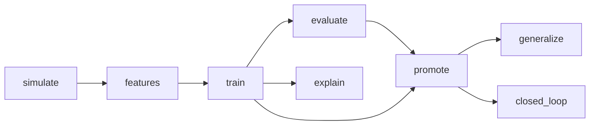
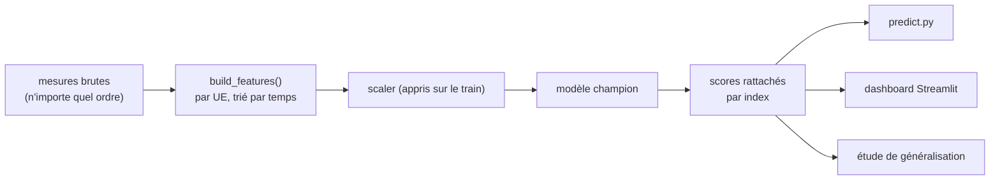

# Chapitre 10 — MLOps, tests et organisation du code

> **Objectif :** savoir expliquer comment le projet est industrialisé (reproductibilité, suivi des expériences, intégration continue, tests, mise à disposition du modèle), et où se trouve chaque chose dans le code.

---

## 10.1 Pourquoi du MLOps sur un projet de simulation ?

Un résultat de ML n'a de valeur que s'il est **reproductible** : quelqu'un d'autre doit pouvoir relancer le pipeline et retrouver les mêmes chiffres. Le projet s'appuie sur trois outils standards, plus des tests :

| Besoin | Outil | Ce qu'il apporte |
|---|---|---|
| rejouer le pipeline sans tout recalculer | **DVC** | graphe d'étapes avec dépendances ; ne relance que ce qui a changé |
| garder la trace des expériences | **MLflow** | hyperparamètres, métriques, modèles et graphiques de chaque entraînement |
| vérifier chaque modification | **GitHub Actions** | à chaque *push*, tests + pipeline complet + publication des rapports |
| garantir les propriétés critiques | **pytest** | 36 tests (physique radio, logique de handover, anti-fuite, inférence) |

## 10.2 Le pipeline DVC



Chaque étape de `dvc.yaml` déclare sa **commande**, ses **dépendances** (code et données) et ses **sorties**. `dvc repro` compare les empreintes (hash) des dépendances avec celles enregistrées dans `dvc.lock`, et ne relance que les étapes périmées. Modifier `src/models.py` relance l'entraînement et ce qui en découle, mais pas la simulation.

| Étape | Commande | Produit |
|---|---|---|
| simulate | `python simulate.py` | `data/raw/dataset.csv` |
| features | `python run_pipeline.py --phase 2` | train / val / test, `scaler.pkl`, `meta.json` |
| train | `--phase 3` | 7 modèles, `thresholds.json` (seuils et métriques de validation) |
| evaluate | `--phase 4` | `evaluation.json`, `operational.json`, courbes ROC/PR, matrices de confusion |
| explain | `--phase 5` | graphiques SHAP |
| promote | `scripts/promote_best_model.py` | `models/champion/` |
| generalize | `python -m src.generalization` | `generalization.json` |
| closed_loop | `python -m src.closed_loop` | `closed_loop.json` |

Les rapports JSON sont versionnés dans Git (`cache: false`) pour que les chiffres du README soient vérifiables. Les modèles et les CSV volumineux sont régénérés.

## 10.3 MLflow : le journal des expériences

Chaque entraînement crée un *run* MLflow (base SQLite locale `mlflow.db`, sans serveur) contenant : hyperparamètres, métriques de **validation** (F1 au seuil choisi, ROC-AUC, PR-AUC, seuil), modèle sérialisé. L'évaluation **reprend le même run** pour y ajouter les métriques de **test** et les graphiques. On peut ainsi comparer les modèles dans l'interface (`mlflow ui --backend-store-uri sqlite:///mlflow.db`) ou dans l'onglet du dashboard.

## 10.4 La sélection du champion

`scripts/promote_best_model.py` choisit le modèle qui maximise, **sur la validation** :

$$score = 0{,}6 \times F1_{val} + 0{,}4 \times AUC_{val}$$

puis le copie dans `models/champion/` avec un `metadata.json` (nom, seuil, métriques de validation et de test). Le F1 pèse davantage parce qu'il reflète le **point de fonctionnement réel** (avec le seuil choisi) ; l'AUC garde un œil sur la qualité du classement à tous les seuils. La règle sans apprentissage est évaluée mais **n'est pas éligible**.

> ⚠️ En v3, la sélection se faisait sur le **test**. C'est une erreur méthodologique : le score de test du champion devient optimiste, puisqu'on a choisi le meilleur sur ces mêmes données. La v4 sélectionne sur la validation et ne lit le test qu'ensuite.

## 10.5 L'intégration continue (GitHub Actions)

À chaque *push* ou *pull request* sur `main` :

1. **job `tests`** : installation, puis `pytest -q` (≈ 10 s) ;
2. **job `pipeline`** (seulement si les tests passent) : `dvc repro` complet (≈ 7 min), puis publication des rapports et des métadonnées du champion comme *artefacts*.

Un cache GitHub du *run-cache* DVC évite de tout recalculer quand le code n'a pas changé.

## 10.6 Les tests

| Fichier | Ce qu'il garantit |
|---|---|
| `test_radio_model.py` | probabilité LOS décroissante, NLOS ≥ LOS, CQI monotone, RSRP dans [−140, −44], **SINR inchangé par le passage au RSRP par RE**, LOS fixe pour un UE immobile, moyennage du fast fading |
| `test_handover_logic.py` | TTT en fonction de la vitesse, déclenchement après exactement TTT pas, remise à zéro, changement de candidate, hystérésis après ping-pong, RLF après échec |
| `test_simulator.py` | même graine → mêmes données ; **une politique ne change pas les trajectoires** ; label correct ; RLF de 3 s exactement ; vitesse nulle à l'arrêt |
| `test_features.py` | 83 variables sans position ni LOS ; **le futur ne modifie pas le passé** ; ordre des lignes sans effet ; parité en ligne / hors ligne |
| `test_serving.py` | un CSV brut est noté de bout en bout ; **mélanger les lignes ne change pas les scores** ; les fenêtres LSTM ne traversent jamais deux UE |
| `test_operational.py` | rappel événementiel, délai d'anticipation, coût des fausses alarmes (une alarme permanente doit coûter cher) |

> 💡 Plusieurs tests **reproduisent un bug de la v3** : ils auraient échoué sur l'ancien code. C'est la bonne manière de figer une correction.

## 10.7 La mise à disposition du modèle

Un seul chemin d'inférence, `src/serving.py`, est partagé par tous les consommateurs :



- **`predict.py`** : `python predict.py --csv mesures.csv` affiche pour chaque ligne la probabilité et la décision au seuil du champion ; `--info` résume le champion.
- **Dashboard Streamlit** (`streamlit run app/dashboard.py`), 9 onglets : KPI radio, chronologie des handovers, carte de risque, prédiction en direct (dépôt d'un CSV), comparaison des modèles (avec métriques événementielles), SHAP, runs MLflow, carte de mobilité, et **Proactive HO** (boucle fermée et généralisation).

## 10.8 Carte du code

```
├── simulate.py                 simulation d'entraînement (wrapper)
├── generate_test_dataset.py    scénarios de test (default, vehicle, stable, cell_edge)
├── run_pipeline.py             phases 2 à 5
├── predict.py                  inférence en ligne de commande
├── src/
│   ├── radio_model.py          propagation, RSRP par RE, SINR, RSRQ, CQI
│   ├── mobility.py             Random Waypoint, vitesse réelle
│   ├── handover_logic.py       filtrage L3, A3 + TTT, échec, ping-pong
│   ├── simulator.py            boucle de simulation partagée, RLF, label
│   ├── features.py             83 variables, build_features, OnlineFeatureBuffer
│   ├── models.py               7 modèles, seuils, scoring séquentiel par UE
│   ├── evaluate.py             métriques sur des lignes communes, courbes
│   ├── operational.py          métriques événementielles
│   ├── explain.py              SHAP
│   ├── serving.py              chemin d'inférence unique
│   ├── closed_loop.py          expérience en boucle fermée
│   └── generalization.py       généralisation
├── scripts/                    promotion du champion, génération des figures
├── app/dashboard.py            dashboard Streamlit
├── tests/                      36 tests pytest
├── notebooks/                  10 notebooks d'analyse
└── docs/                       README technique, rapport, ce cours
```

⬅️ [Chapitre 9](09_boucle_fermee_et_generalisation.md) · ➡️ [Chapitre 11 — préparer l'entretien](11_preparer_entretien.md)
